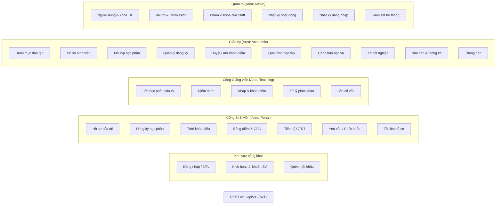
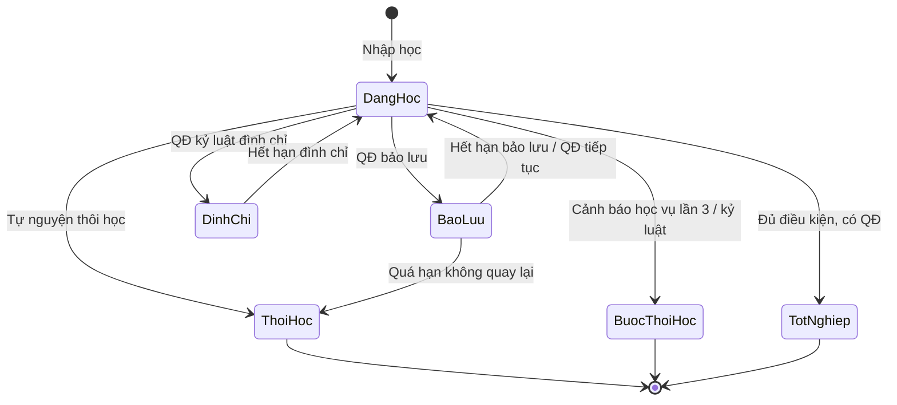
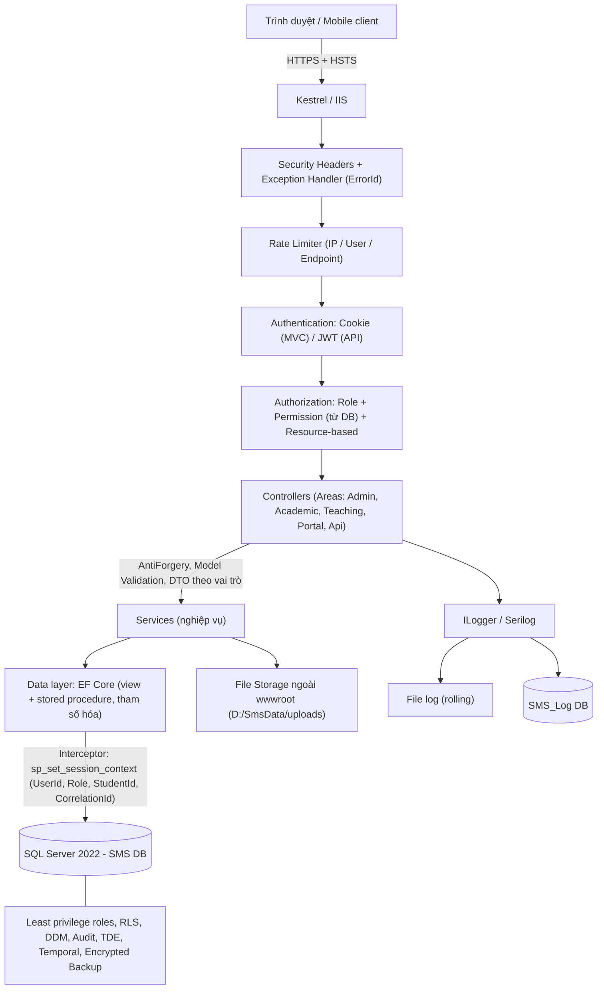
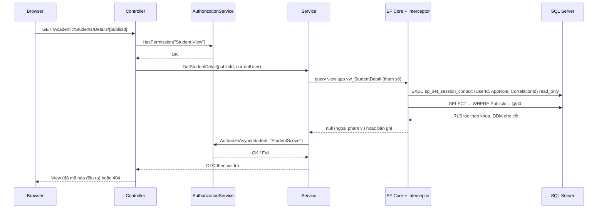
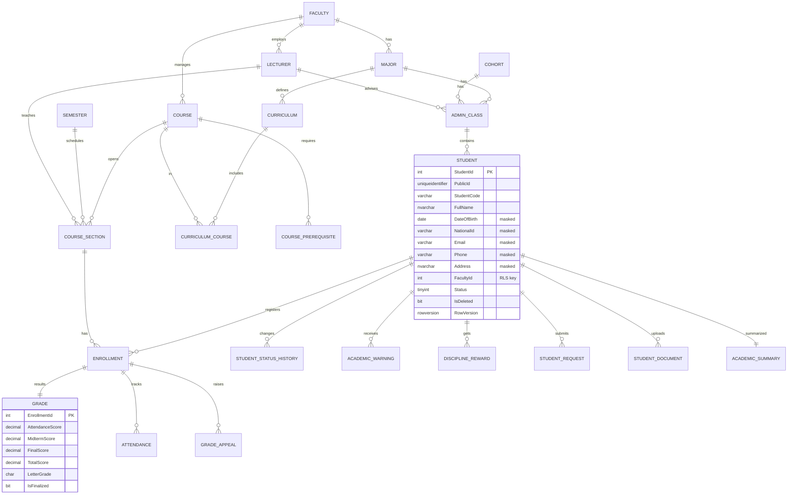

# KẾ HOẠCH XÂY DỰNG HỆ THỐNG QUẢN LÝ SINH VIÊN & QUÁ TRÌNH THEO HỌC (SMS)

> **Mã dự án:** M03 – Student Management System (SMS)
> **Tech stack:** ASP.NET Core MVC (.NET 10 – project `M03.csproj` hiện có) · Entity Framework Core 10 · SQL Server 2022 · ASP.NET Core Identity · Bootstrap 5
> **Yêu cầu bắt buộc:** Vượt qua toàn bộ **30 tình huống bảo mật** trong file [Tình Huống Bảo Mật.md](file:///c:/Users/Admin/Desktop/M03_Opus/Tình%20Huống%20Bảo%20Mật.md) (nhóm A – SQL Server, B – ASP.NET, C – Nâng cao, D – Chống tấn công).

---

## Mục lục

1. [Tổng quan & phạm vi](#1-tổng-quan--phạm-vi)
2. [Vai trò người dùng & ma trận phân quyền](#2-vai-trò-người-dùng--ma-trận-phân-quyền)
3. [Đề xuất chức năng hệ thống](#3-đề-xuất-chức-năng-hệ-thống)
4. [Quy tắc nghiệp vụ chính](#4-quy-tắc-nghiệp-vụ-chính)
5. [Kiến trúc tổng thể](#5-kiến-trúc-tổng-thể)
6. [Thiết kế cơ sở dữ liệu](#6-thiết-kế-cơ-sở-dữ-liệu)
7. [Ma trận truy vết 30 tình huống bảo mật](#7-ma-trận-truy-vết-30-tình-huống-bảo-mật)
8. [Nhóm A – Bảo mật SQL Server (1–8)](#8-nhóm-a--bảo-mật-sql-server-18)
9. [Nhóm B – Bảo mật lập trình ASP.NET (9–15)](#9-nhóm-b--bảo-mật-lập-trình-aspnet-915)
10. [Nhóm C – Thực hành nâng cao (16–25)](#10-nhóm-c--thực-hành-nâng-cao-1625)
11. [Nhóm D – Chống tấn công (26–30)](#11-nhóm-d--chống-tấn-công-2630)
12. [Kế hoạch kiểm thử bảo mật](#12-kế-hoạch-kiểm-thử-bảo-mật)
13. [Lộ trình triển khai](#13-lộ-trình-triển-khai)
14. [Sản phẩm bàn giao & tiêu chí hoàn thành](#14-sản-phẩm-bàn-giao--tiêu-chí-hoàn-thành)
15. [Rủi ro & biện pháp giảm thiểu](#15-rủi-ro--biện-pháp-giảm-thiểu)
16. [Phụ lục](#16-phụ-lục)

---

## 1. Tổng quan & phạm vi

### 1.1. Mục tiêu
Xây dựng hệ thống web giúp nhà trường quản lý **hồ sơ sinh viên** và toàn bộ **quá trình theo học**: nhập học → đăng ký học phần → học tập, điểm danh → nhập/duyệt điểm → cảnh báo học vụ → bảo lưu/thôi học/kỷ luật → xét tốt nghiệp. Hệ thống được thiết kế **"secure by design"**: mỗi chức năng nghiệp vụ đồng thời là một "điểm thực hành" cho một hoặc nhiều tình huống bảo mật.

### 1.2. Phạm vi
| Trong phạm vi | Ngoài phạm vi (giai đoạn sau) |
| :--- | :--- |
| Quản lý danh mục, hồ sơ SV, lớp học phần, đăng ký học phần, điểm, quá trình học tập, cảnh báo học vụ, xét tốt nghiệp | Thanh toán học phí trực tuyến |
| Cổng sinh viên, cổng giảng viên, khu vực giáo vụ, khu vực quản trị | Ứng dụng di động (chỉ cung cấp REST API sẵn sàng cho mobile) |
| REST API có xác thực JWT | Tích hợp SSO/LDAP của trường |
| Toàn bộ cấu hình bảo mật SQL Server (RLS, DDM, Audit, TDE, Backup…) | High Availability (Always On) |

### 1.3. Công nghệ & môi trường
| Thành phần | Lựa chọn | Ghi chú |
| :--- | :--- | :--- |
| Web framework | ASP.NET Core MVC, .NET 10 (SDK 10.0.401) | Dùng project `M03` hiện có, tổ chức theo **Areas** |
| ORM / Data access | EF Core 10 (`Microsoft.EntityFrameworkCore.SqlServer`) + `Microsoft.Data.SqlClient` | Đọc qua **view**, ghi qua **stored procedure** |
| Xác thực | ASP.NET Core Identity (cookie cho MVC) + JWT Bearer (cho API) | 2FA TOTP bắt buộc với `Administrator` |
| CSDL | SQL Server 2022 **Developer Edition** (lab) / Standard trở lên (production) | Cần SQL Agent, TDE, Backup Encryption, Audit, RLS, DDM, Temporal Table |
| Logging | `ILogger` + Serilog (File + MSSqlServer sink vào DB log riêng) | |
| UI | Razor Views, Bootstrap 5, jQuery Validation (đã có trong `wwwroot/lib`) | |
| Thư viện phụ | `HtmlSanitizer` (Ganss.Xss), `ClosedXML` (xuất Excel) | Được rà soát ở tình huống 28–29 |
| Kiểm thử | xUnit + `WebApplicationFactory`, Postman/curl, k6, OWASP ZAP (lab) | |
| IDE / công cụ | Visual Studio 2026, SSMS 21, Git | |

### 1.4. Giả định
- Mọi thử nghiệm tấn công (SQLi, XSS, CSRF, DoS, upload độc hại) **chỉ thực hiện trong môi trường lab** với dữ liệu giả.
- Có 2 instance SQL Server để thử khôi phục TDE/backup: `.\SMS_MAIN` và `.\SMS_RESTORE` (có thể dùng container Docker `mcr.microsoft.com/mssql/server:2022-latest` làm instance thứ hai).
- Hệ thống chạy sau IIS hoặc Kestrel với HTTPS.

---

## 2. Vai trò người dùng & ma trận phân quyền

### 2.1. Vai trò ứng dụng (ASP.NET Identity)
| Vai trò | Ánh xạ với tài liệu bảo mật | Mô tả | Phạm vi dữ liệu |
| :--- | :--- | :--- | :--- |
| `Administrator` | `Administrator` | Quản trị hệ thống, người dùng, quyền, nhật ký; xem được dữ liệu nhạy cảm bản rõ | Toàn trường |
| `Staff` | `Staff` | Giáo vụ / Phòng Đào tạo của khoa: quản lý hồ sơ SV, lớp học phần, trạng thái học tập, duyệt điểm, báo cáo | **Chỉ khoa được giao** (RLS) |
| `Lecturer` | (mở rộng của `Staff` cấp thấp) | Giảng viên: xem danh sách lớp, nhập điểm, điểm danh, xử lý phúc khảo | **Chỉ lớp học phần mình dạy** + lớp mình làm cố vấn |
| `Student` | `User` | Sinh viên: xem/cập nhật hồ sơ của chính mình, đăng ký học phần, xem điểm, gửi yêu cầu | **Chỉ bản ghi của chính mình** |

> [!IMPORTANT]
> Vai trò chỉ là "nhóm quyền". Quyền thực sự được kiểm tra theo **Permission** đọc từ CSDL (tình huống 16), và được chặn **ở action phía server**, không chỉ ẩn menu.

### 2.2. Danh mục Permission (lưu trong bảng `auth.Permissions`)
| Nhóm | Permission |
| :--- | :--- |
| Sinh viên | `Student.View`, `Student.Create`, `Student.Edit`, `Student.Delete`, `Student.ChangeStatus`, `Student.ViewSensitive`, `Student.Export` |
| Danh mục | `Catalog.Manage` (khoa, ngành, khóa, lớp, môn, học kỳ, CTĐT) |
| Lớp học phần | `Section.Manage`, `Section.ViewOwn` |
| Đăng ký học phần | `Enrollment.Manage`, `Enrollment.Self` |
| Điểm | `Grade.Enter`, `Grade.Finalize`, `Grade.Unlock`, `Grade.ViewOwn`, `Grade.ViewScope` |
| Yêu cầu / phúc khảo | `Request.Submit`, `Request.Resolve` |
| Tài liệu | `Document.Upload`, `Document.DownloadScope`, `Document.DownloadOwn` |
| Báo cáo | `Report.View`, `Report.ViewSensitive`, `Report.Export` |
| Thông báo | `Announcement.Manage` |
| Hệ thống | `User.Manage`, `Role.Manage`, `Audit.View`, `System.Config` |

### 2.3. Ma trận Vai trò – Permission (dữ liệu khởi tạo)
| Permission | Administrator | Staff | Lecturer | Student |
| :--- | :---: | :---: | :---: | :---: |
| Student.View / Create / Edit | ✅ | ✅ (khoa mình) | 👁 View (lớp mình) | ❌ |
| Student.Delete (xóa mềm) | ✅ | ❌ | ❌ | ❌ |
| Student.ChangeStatus | ✅ | ✅ | ❌ | ❌ |
| Student.ViewSensitive / Report.ViewSensitive | ✅ | ❌ (bị che) | ❌ | ❌ |
| Catalog.Manage | ✅ | ✅ | ❌ | ❌ |
| Section.Manage / Enrollment.Manage | ✅ | ✅ | ❌ | ❌ |
| Grade.Enter | ❌ | ❌ | ✅ (lớp mình) | ❌ |
| Grade.Finalize / Grade.Unlock | ✅ | ✅ | Finalize lớp mình | ❌ |
| Grade.ViewOwn / Enrollment.Self / Request.Submit / Document.DownloadOwn | ❌ | ❌ | ❌ | ✅ |
| Request.Resolve | ✅ | ✅ | ✅ (phúc khảo lớp mình) | ❌ |
| Document.Upload | ✅ | ✅ | ❌ | ✅ (hồ sơ của mình) |
| Report.View / Report.Export | ✅ | ✅ | ✅ (lớp mình) | ❌ |
| Announcement.Manage | ✅ | ✅ | ❌ | ❌ |
| User.Manage / Role.Manage / Audit.View / System.Config | ✅ | ❌ | ❌ | ❌ |

---

## 3. Đề xuất chức năng hệ thống

### 3.1. Sơ đồ phân hệ


### 3.2. Danh sách chức năng chi tiết

#### M1 – Xác thực & tài khoản (mọi vai trò)
| Mã | Chức năng | Mô tả | Tình huống BM liên quan |
| :--- | :--- | :--- | :--- |
| F1.1 | Đăng nhập | Email/MSSV + mật khẩu; khóa TK sau 5 lần sai; thông báo lỗi chung (không lộ TK tồn tại hay không) | 9, 15, 26 |
| F1.2 | Xác thực 2 lớp (TOTP) | Bắt buộc với `Administrator`, tùy chọn cho vai trò khác | 16 |
| F1.3 | Kích hoạt tài khoản SV (đăng ký) | SV nhập MSSV + email trường đã có trong hồ sơ → nhận email xác nhận → đặt mật khẩu mạnh | 9, 17 |
| F1.4 | Quên / đặt lại mật khẩu | Token dùng 1 lần, hết hạn 30 phút | 17 |
| F1.5 | Đổi mật khẩu | Bắt buộc nhập mật khẩu hiện tại; kiểm tra độ mạnh; không trùng 5 mật khẩu gần nhất | 12, 17 |
| F1.6 | Đăng xuất, hết hạn phiên | Idle 30 phút, tuyệt đối 8 giờ | 16 |
| F1.7 | Lịch sử đăng nhập của tôi | Thời điểm, IP, thiết bị, cảnh báo đăng nhập lạ | 8, 20 |

#### M2 – Danh mục đào tạo (Staff, Admin)
| Mã | Chức năng | Mô tả |
| :--- | :--- | :--- |
| F2.1 | Khoa | CRUD khoa (mã, tên, trạng thái) |
| F2.2 | Ngành | CRUD ngành thuộc khoa |
| F2.3 | Khóa / niên khóa | K2023, K2024… |
| F2.4 | Lớp sinh hoạt | Lớp theo ngành + khóa, gán giảng viên cố vấn |
| F2.5 | Học kỳ | Ngày bắt đầu/kết thúc, khung thời gian đăng ký, hạn nhập điểm, học kỳ hiện hành |
| F2.6 | Môn học | Mã, tên, số tín chỉ, trọng số điểm, **môn tiên quyết** |
| F2.7 | Chương trình đào tạo (CTĐT) | Danh sách môn bắt buộc/tự chọn theo ngành + khóa, tổng tín chỉ yêu cầu |
| F2.8 | Giảng viên | Hồ sơ giảng viên (email/điện thoại được che) |

> Danh mục ít thay đổi → được **cache** (tình huống 26).

#### M3 – Hồ sơ sinh viên (Staff, Admin)
| Mã | Chức năng | Mô tả | Tình huống BM |
| :--- | :--- | :--- | :--- |
| F3.1 | Danh sách & tìm kiếm nhiều điều kiện | Theo MSSV/họ tên, khoa, ngành, khóa, lớp, trạng thái, khoảng ngày nhập học; sắp xếp theo whitelist; phân trang | 3, 10, 19, 27 |
| F3.2 | Thêm / sửa hồ sơ | Họ tên, giới tính, ngày sinh, CCCD, email, SĐT, địa chỉ, lớp, ngành… (qua stored procedure có kiểm tra) | 2, 12, 20 |
| F3.3 | Xem chi tiết hồ sơ | Dữ liệu nhạy cảm bị che với Staff, bản rõ với Admin | 4, 18, 21 |
| F3.4 | Xóa mềm hồ sơ | Chỉ Admin; không xóa vật lý | 1, 9, 22 |
| F3.5 | Ảnh thẻ & tài liệu hồ sơ | Upload ảnh thẻ, bản scan CCCD, bằng THPT, giấy khai sinh (PDF/JPG/PNG) | 14, 30 |
| F3.6 | Lịch sử thay đổi hồ sơ | Xem các phiên bản cũ (Temporal Table) | 20, 24 |

#### M4 – Lớp học phần & đăng ký học phần
| Mã | Chức năng | Vai trò |
| :--- | :--- | :--- |
| F4.1 | Mở lớp học phần theo học kỳ (môn, GV, sĩ số, phòng, lịch học) | Staff |
| F4.2 | Phân công giảng viên | Staff |
| F4.3 | Sinh viên đăng ký / hủy đăng ký học phần (kiểm tra thời gian, tiên quyết, trùng lịch, sĩ số, giới hạn tín chỉ) | Student |
| F4.4 | Giáo vụ đăng ký hộ / xử lý ngoại lệ | Staff |
| F4.5 | Thời khóa biểu cá nhân | Student, Lecturer |
| F4.6 | Danh sách lớp học phần (chỉ MSSV, họ tên, lớp – không có dữ liệu nhạy cảm) | Lecturer, Staff |

#### M5 – Điểm danh & điểm số
| Mã | Chức năng | Vai trò |
| :--- | :--- | :--- |
| F5.1 | Điểm danh theo buổi học | Lecturer |
| F5.2 | Nhập điểm thành phần (chuyên cần, giữa kỳ, cuối kỳ) – tự tính điểm tổng, điểm chữ, điểm hệ 4 | Lecturer |
| F5.3 | Khóa điểm (chốt) lớp học phần | Lecturer / Staff |
| F5.4 | Mở khóa điểm có lý do (ghi nhật ký) | Staff (`Grade.Unlock`) |
| F5.5 | Phúc khảo: SV gửi đơn → GV xử lý → Staff duyệt | Student → Lecturer → Staff |
| F5.6 | Bảng điểm cá nhân, GPA học kỳ & tích lũy | Student |

#### M6 – Quá trình học tập (trọng tâm "quá trình theo học")
| Mã | Chức năng | Mô tả |
| :--- | :--- | :--- |
| F6.1 | Trạng thái học tập | Đang học, Bảo lưu, Đình chỉ, Thôi học, Buộc thôi học, Tốt nghiệp – đổi trạng thái phải có số quyết định, ngày hiệu lực |
| F6.2 | Lịch sử trạng thái | Dòng thời gian toàn bộ quá trình của SV |
| F6.3 | Cảnh báo học vụ | Tự động xét cuối học kỳ theo GPA (job/stored procedure), Staff xác nhận |
| F6.4 | Khen thưởng / kỷ luật | Ghi nhận quyết định, nội dung, thời hạn |
| F6.5 | Tiến độ CTĐT | Số tín chỉ tích lũy / yêu cầu, môn còn thiếu, môn nợ (F) |
| F6.6 | Xét tốt nghiệp | Danh sách SV đủ điều kiện (tín chỉ, GPA ≥ 2.0, không nợ môn bắt buộc, không đang kỷ luật) |
| F6.7 | Yêu cầu hành chính | SV gửi đơn bảo lưu, xác nhận SV, học lại… kèm tệp đính kèm; Staff xử lý |

#### M7 – Báo cáo & thống kê (Staff, Admin, Lecturer giới hạn)
| Mã | Báo cáo | Ghi chú bảo mật |
| :--- | :--- | :--- |
| R1 | Danh sách SV theo lớp/khoa (có SĐT, email) | Staff thấy dữ liệu che; Admin thấy bản rõ (tình huống 21) |
| R2 | Bảng điểm lớp học phần | Chỉ GV phụ trách/Staff khoa |
| R3 | Thống kê GPA, tỷ lệ đạt/rớt theo môn, theo khoa | Stored procedure + phân trang + index (27) |
| R4 | Danh sách cảnh báo học vụ | |
| R5 | Danh sách đủ điều kiện tốt nghiệp | |
| R6 | Xuất Excel các báo cáo trên | Cùng DTO theo vai trò; chống CSV/Excel formula injection |

#### M8 – Thông báo & phản hồi
| Mã | Chức năng | Ghi chú |
| :--- | :--- | :--- |
| F8.1 | Thông báo (rich text) của khoa/trường | HTML được **sanitize** bằng whitelist (tình huống 11) |
| F8.2 | Góp ý / phản hồi của SV, GV phản hồi | Văn bản thuần, mã hóa đầu ra (11) |

#### M9 – Quản trị hệ thống (Administrator)
| Mã | Chức năng |
| :--- | :--- |
| F9.1 | Quản lý người dùng: tạo TK Staff/Lecturer, khóa/mở khóa, vô hiệu hóa (không xóa), reset 2FA |
| F9.2 | Quản lý vai trò & permission (bảng trong CSDL) |
| F9.3 | Gán phạm vi khoa cho Staff (dữ liệu dùng cho RLS) |
| F9.4 | Nhật ký hoạt động (ứng dụng) & nhật ký thay đổi dữ liệu (CSDL), đối chiếu theo CorrelationId |
| F9.5 | Nhật ký đăng nhập, cảnh báo bất thường (sai nhiều lần, ngoài giờ, thiết bị lạ) |
| F9.6 | Giám sát: health check, số request bị rate limit, lỗi gần đây |

#### M10 – REST API `/api/v1` (JWT)
| Endpoint | Method | Quyền |
| :--- | :--- | :--- |
| `/api/v1/auth/token` | POST | Anonymous (có rate limit, lockout) |
| `/api/v1/students` | GET (phân trang, lọc) | `Student.View` |
| `/api/v1/students/{publicId}` | GET | `Student.View` + phạm vi |
| `/api/v1/students` | POST | `Student.Create` |
| `/api/v1/students/{publicId}` | PUT | `Student.Edit` |
| `/api/v1/students/{publicId}` | DELETE | `Student.Delete` (chỉ Admin) |
| `/api/v1/me/profile`, `/api/v1/me/grades`, `/api/v1/me/enrollments` | GET | `Student` – luôn lấy theo danh tính trong token |
| `/api/v1/sections/{id}/grades` | PUT | `Grade.Enter` + GV phụ trách |

#### M11 – Khu vực thực hành bảo mật (chỉ Development)
Area `SecurityLab`, chỉ đăng ký route khi `Environment = Development` **và** `Lab:Enabled = true`, mã nguồn bọc `#if DEBUG` để không có trong bản Release:
- Tìm kiếm SV **bản nối chuỗi** vs **bản tham số** (tình huống 10, 19) trên bảng giả `lab.StudentSample`, dùng login `sms_lab` chỉ có `SELECT` trên đúng bảng đó.
- Hiển thị bình luận **bản `Html.Raw`** vs **bản mã hóa** (tình huống 11).
- Endpoint gây lỗi có chủ đích để so sánh trang lỗi (tình huống 23).

---

## 4. Quy tắc nghiệp vụ chính

### 4.1. Vòng đời trạng thái sinh viên

- Mọi chuyển trạng thái thực hiện qua `app.usp_Student_ChangeStatus` – procedure **kiểm tra chuyển trạng thái hợp lệ**, bắt buộc có số quyết định, ghi `edu.StudentStatusHistory` và `audit.DataChangeLog`.
- Bảo lưu tối đa 2 học kỳ cộng dồn (cấu hình được).

### 4.2. Đăng ký học phần (`app.usp_Enrollment_Register`)
1. SV ở trạng thái **Đang học**.
2. Trong khung `RegistrationStart`–`RegistrationEnd` của học kỳ.
3. Lớp học phần ở trạng thái `Open`, còn chỗ (dùng `UPDLOCK, HOLDLOCK` chống vượt sĩ số khi nhiều SV đăng ký đồng thời).
4. Đã đạt các môn tiên quyết (điểm tổng ≥ 4.0).
5. Không trùng lịch với lớp đã đăng ký.
6. Tổng tín chỉ trong kỳ ≤ 25 (≤ 14 nếu đang bị cảnh báo học vụ).
7. Chưa đạt môn đó, hoặc đăng ký học cải thiện (điểm < C).

### 4.3. Tính điểm
- Điểm tổng = Chuyên cần × w1 + Giữa kỳ × w2 + Cuối kỳ × w3 (mặc định 10% / 30% / 60%, cấu hình theo môn, tổng = 100%).
- Điểm số trong khoảng 0–10, làm tròn 0.1; procedure từ chối giá trị ngoài miền.

| Điểm 10 | ≥ 8.5 | 8.0–8.4 | 7.0–7.9 | 6.5–6.9 | 5.5–6.4 | 5.0–5.4 | 4.0–4.9 | < 4.0 |
| :--- | :---: | :---: | :---: | :---: | :---: | :---: | :---: | :---: |
| Điểm chữ | A | B+ | B | C+ | C | D+ | D | F |
| Hệ 4 | 4.0 | 3.5 | 3.0 | 2.5 | 2.0 | 1.5 | 1.0 | 0 |

- GV chỉ nhập điểm cho lớp mình dạy, trước `GradeEntryDeadline`, khi lớp chưa khóa điểm.
- Sau khi khóa điểm, chỉ Staff có `Grade.Unlock` mới mở khóa, bắt buộc nhập lý do.
- Phúc khảo trong vòng 7 ngày sau khi khóa điểm, mỗi học phần 1 lần.
- Khi điểm được chốt, procedure cập nhật bảng tổng hợp `edu.StudentAcademicSummary` (GPA, tín chỉ tích lũy) → báo cáo không phải tính lại trên bảng lớn (tình huống 27).

### 4.4. Cảnh báo học vụ & tốt nghiệp
- **Cảnh báo mức 1:** GPA học kỳ < 1.0 hoặc GPA tích lũy < 1.2 (năm 1), < 1.4 (năm 2), < 1.6 (năm 3), < 1.8 (từ năm 4).
- **Mức 2:** bị cảnh báo 2 kỳ liên tiếp; **Mức 3:** 3 kỳ liên tiếp → đề xuất buộc thôi học.
- **Tốt nghiệp:** đủ tín chỉ CTĐT, GPA tích lũy ≥ 2.0, không còn môn bắt buộc bị F, không đang bị kỷ luật.

### 4.5. Chính sách xóa dữ liệu
- Không xóa vật lý hồ sơ SV, điểm, nhật ký. "Xóa" = **xóa mềm** (`IsDeleted = 1`) và chỉ Admin được làm.
- Tài khoản SQL/ứng dụng không dùng nữa → **disable**, không xóa (giữ truy vết).

---

## 5. Kiến trúc tổng thể

### 5.1. Sơ đồ kiến trúc & các lớp bảo vệ


### 5.2. Nguyên tắc kiến trúc
- **Defense in depth:** mỗi kiểm soát quan trọng có ít nhất 2 tầng (ví dụ: phạm vi dữ liệu = kiểm tra ở service **và** RLS ở SQL; che dữ liệu = DTO theo vai trò **và** DDM).
- **Fail closed:** thiếu `SESSION_CONTEXT` → RLS trả về 0 dòng; thiếu permission → 403.
- **Không tin client:** không lấy bản ghi chỉ vì client gửi ID; không tin tên file; không tin cột sắp xếp.
- **Least privilege:** ứng dụng không bao giờ dùng `sa`; tài khoản ứng dụng không có quyền trên bảng gốc, không có `DELETE`, không có DDL.

### 5.3. Cấu trúc thư mục dự án
```text
M03_Opus/
├── M03.csproj / M03.slnx
├── Program.cs                       # Đăng ký dịch vụ & pipeline bảo mật
├── appsettings.json                 # KHÔNG chứa secret
├── appsettings.Development.json     # KHÔNG chứa secret, không publish
├── appsettings.Production.json      # AllowedHosts, log level – không secret
├── Areas/
│   ├── Admin/        (Users, Roles, Permissions, Scopes, AuditLogs, LoginLogs, Monitoring)
│   ├── Academic/     (Faculties, Majors, Cohorts, Classes, Semesters, Courses, Curricula,
│   │                  Students, Sections, Enrollments, Grades, Status, Warnings, Graduation, Reports, Announcements)
│   ├── Teaching/     (MySections, Attendance, GradeEntry, Appeals, AdvisorClass)
│   ├── Portal/       (Profile, Registration, Timetable, Transcript, Progress, Requests, Documents)
│   └── SecurityLab/  (#if DEBUG – chỉ Development)
├── Controllers/
│   ├── HomeController.cs, AccountController.cs, ErrorController.cs
│   └── Api/V1/       (AuthController, StudentsController, MeController, SectionGradesController)
├── Data/
│   ├── AuthDbContext.cs             # Identity (schema auth)
│   ├── SmsDbContext.cs              # Nghiệp vụ: map view (đọc) + gọi procedure (ghi)
│   ├── SessionContextInterceptor.cs # sp_set_session_context
│   └── SqlConnectionFactory.cs      # Chọn connection theo tầng quyền
├── Domain/        (Entities, Enums)
├── Models/        (ViewModels, InputModels, DTO theo vai trò)
├── Services/      (StudentService, EnrollmentService, GradeService, ReportService, ExportService, ...)
├── Security/
│   ├── Authorization/   (PermissionRequirement, PermissionPolicyProvider, HasPermissionAttribute,
│   │                     StudentScopeHandler, SectionOwnerHandler)
│   ├── PermissionClaimsFactory.cs   # Nạp permission từ DB khi đăng nhập
│   ├── PasswordHistoryValidator.cs
│   ├── SecurityHeadersMiddleware.cs
│   └── AntiforgeryFailureLogger.cs
├── Infrastructure/
│   ├── Files/     (SecureFileStorage, FileSignatureValidator, FileNameSanitizer)
│   ├── Logging/   (SensitiveDataMaskingEnricher, AuditLogger)
│   ├── Errors/    (GlobalExceptionHandler, SqlErrorTranslator)
│   └── Caching/   (CatalogCache)
├── Views/ ...     (Razor – KHÔNG dùng Html.Raw cho dữ liệu người dùng)
├── wwwroot/       (chỉ tài nguyên tĩnh – không chứa file upload)
├── Database/      # Script SQL do DBA chạy theo thứ tự
│   ├── 00_server_hardening.sql      (disable sa, login policy)
│   ├── 01_create_database.sql
│   ├── 02_schemas_tables.sql
│   ├── 03_identity_tables.sql       (sinh từ `dotnet ef migrations script`)
│   ├── 04_views.sql
│   ├── 05_procedures.sql
│   ├── 06_logins_users_roles.sql
│   ├── 07_permissions_grant_deny.sql
│   ├── 08_rls.sql
│   ├── 09_ddm.sql
│   ├── 10_audit.sql
│   ├── 11_tde.sql
│   ├── 12_backup_jobs.sql
│   ├── 13_login_monitoring.sql
│   ├── 14_indexes_querystore.sql
│   ├── 15_seed_data.sql             (dữ liệu giả)
│   ├── 16_perf_seed_200k.sql        (dữ liệu lớn cho lab hiệu năng)
│   └── verify/                      (script kiểm tra cho từng tình huống)
├── tests/
│   └── M03.SecurityTests/  (xUnit + WebApplicationFactory: 401/403, CSRF, IDOR, upload, headers)
└── docs/
    ├── security-test-report.md
    ├── code-review-report.md
    └── evidence/   (ảnh chụp, log trích xuất)
```

### 5.4. Luồng truy cập dữ liệu


---

## 6. Thiết kế cơ sở dữ liệu

### 6.1. Database & schema
| Database | Schema | Nội dung |
| :--- | :--- | :--- |
| `SMS` | `edu` | Bảng nghiệp vụ gốc (không ai trong nhóm nghiệp vụ được truy cập trực tiếp) |
| | `app` | View & stored procedure cho ứng dụng |
| | `rpt` | View báo cáo giới hạn cột (cho `SMS_ReadOnly`) |
| | `auth` | Identity, Permission, RolePermission, PasswordHistory |
| | `sec` | Hàm predicate RLS, bảng phạm vi (UserFacultyScope, DbUserFacultyMap), LoginEventLog |
| | `audit` | ActivityLog (ứng dụng), DataChangeLog (CSDL), AuditFileArchive |
| | `lab` | Bảng dữ liệu giả cho demo SQLi/XSS |
| `SMS_Log` | `log` | Serilog `AppLogs` – tách riêng, login ghi log chỉ có `INSERT` |

> Tất cả schema `edu`, `app`, `rpt`, `sec` thuộc owner `dbo` để **ownership chaining** hoạt động: cấp `EXECUTE` trên procedure / `SELECT` trên view là đủ, không cần quyền trên bảng gốc.

### 6.2. Sơ đồ ERD (rút gọn)


### 6.3. Danh sách bảng chính
| Bảng | Cột chính | Ghi chú bảo mật |
| :--- | :--- | :--- |
| `edu.Faculties` | FacultyId, Code, Name, IsActive | |
| `edu.Majors` | MajorId, FacultyId, Code, Name | |
| `edu.Cohorts` | CohortId, Code, StartYear | |
| `edu.AdminClasses` | ClassId, Code, MajorId, CohortId, AdvisorLecturerId | |
| `edu.Lecturers` | LecturerId, UserId, Code, FullName, FacultyId, Email, Phone | DDM Email/Phone |
| `edu.Students` | xem ERD; + UserId, ClassId, MajorId, CohortId, AdmissionDate, CreatedBy/At, UpdatedBy/At | **RLS + DDM + Temporal + Audit SELECT** |
| `edu.StudentStatusHistory` | Id, StudentId, FromStatus, ToStatus, DecisionNo, EffectiveDate, Reason, CreatedBy | RLS |
| `edu.Semesters` | SemesterId, Code, StartDate, EndDate, RegistrationStart/End, GradeEntryDeadline, IsCurrent | |
| `edu.Courses` | CourseId, Code, Name, Credits, FacultyId, W1, W2, W3 | CHECK W1+W2+W3 = 100 |
| `edu.CoursePrerequisites` | CourseId, PrerequisiteCourseId | |
| `edu.Curricula` / `edu.CurriculumCourses` | MajorId, CohortId, TotalCredits / CourseId, IsMandatory, SuggestedSemester | |
| `edu.CourseSections` | SectionId, CourseId, SemesterId, Code, LecturerId, Capacity, Room, DayOfWeek, StartPeriod, EndPeriod, Status, IsGradeLocked | |
| `edu.Enrollments` | EnrollmentId, StudentId, SectionId, RegisteredAt, Status | RLS (qua StudentId) |
| `edu.Grades` | xem ERD; + EnteredBy, EnteredAt | **Temporal + RLS + Audit UPDATE** |
| `edu.Attendance` | EnrollmentId, SessionDate, Status | |
| `edu.GradeAppeals` | AppealId, EnrollmentId, Reason, Status, Response, ResolvedBy | Văn bản → mã hóa đầu ra |
| `edu.AcademicWarnings` | StudentId, SemesterId, Level, SemesterGpa, CumulativeGpa | |
| `edu.StudentAcademicSummary` | StudentId, CumulativeCredits, CumulativeGpa, LastSemesterGpa, UpdatedAt | Bảng tổng hợp cho báo cáo |
| `edu.DisciplineRewards` | Id, StudentId, Type, DecisionNo, DecisionDate, Content | |
| `edu.StudentRequests` | RequestId, StudentId, Type, Content, Status, HandledBy | |
| `edu.StudentDocuments` | DocumentId, StudentId, StoredFileName (GUID), OriginalFileName (đã làm sạch), ContentType, SizeBytes, Sha256, UploadedBy, UploadedAt | Metadata upload |
| `edu.Announcements` | Id, Title, BodyHtml (đã sanitize), FacultyId, PublishedBy, PublishedAt | |
| `auth.AspNet*` | Bảng Identity | `PasswordHash` (PBKDF2), không có mật khẩu rõ |
| `auth.Permissions` / `auth.RolePermissions` | PermissionId, Code, Description / RoleId, PermissionId | Tình huống 16 |
| `auth.PasswordHistory` | UserId, PasswordHash, ChangedAt | Tình huống 17 |
| `auth.LoginHistory` | UserId, UserName, Succeeded, FailureReason, Ip, UserAgent, IsUnusual, At | Tình huống 8, 15, 20 |
| `sec.UserFacultyScope` | UserId, FacultyId | Nguồn dữ liệu RLS cho Staff |
| `sec.DbUserFacultyMap` | DbUserName, FacultyId | RLS cho login SQL theo khoa |
| `sec.LoginEventLog` | LoginName, HostName, AppName, ClientIp, EventTime, Allowed | Ghi bởi logon trigger |
| `audit.ActivityLog` | Id, At, UserId, UserName, Action, Entity, EntityKey, Summary, Ip, UserAgent, CorrelationId | Log ứng dụng |
| `audit.DataChangeLog` | Id, At, AppUserId, AppUserName, DbUser, Action, TableName, RecordKey, OldValues, NewValues (JSON, đã loại cột nhạy cảm), CorrelationId | Ghi bởi procedure |

### 6.4. Index chính (tình huống 27)
| Bảng | Index |
| :--- | :--- |
| `edu.Students` | UNIQUE(StudentCode); UNIQUE(PublicId); (FacultyId, Status) INCLUDE(FullName, StudentCode, ClassId); (FullName); (ClassId) |
| `edu.Enrollments` | UNIQUE(StudentId, SectionId); (SectionId) INCLUDE(StudentId, Status) |
| `edu.CourseSections` | (SemesterId, CourseId); (LecturerId, SemesterId) |
| `edu.Grades` | PK(EnrollmentId) |
| `sec.UserFacultyScope` | PK(UserId, FacultyId) – predicate RLS tra cứu nhanh |
| `audit.*` | (At), (CorrelationId), (AppUserId, At) |

---

## 7. Ma trận truy vết 30 tình huống bảo mật

| # | Tình huống | Hiện thực trong hệ thống SMS | Chức năng gắn kèm | Script / mã nguồn |
| :---: | :--- | :--- | :--- | :--- |
| 1 | Đặc quyền tối thiểu | Login/role SQL theo nghiệp vụ: `SMS_ReadOnly`, `SMS_DataEntry`, `SMS_Auditor`, `SMS_App`…; DENY thao tác vượt quyền; `sa` bị disable | Toàn hệ thống | `06_`, `07_` |
| 2 | Quyền bảng/view/procedure | Ứng dụng đọc qua view `app.*`, ghi qua `app.usp_*`; không có quyền trên `edu.*` | F3.x, F4.x, F5.x | `04_`, `05_`, `07_` |
| 3 | Row-Level Security | Staff chỉ thấy SV khoa mình; SV chỉ thấy mình; GV chỉ thấy SV lớp mình; FILTER + BLOCK predicate | F3.1, R1–R5 | `08_rls.sql` |
| 4 | Dynamic Data Masking | Che Email, SĐT, CCCD, ngày sinh, địa chỉ; `UNMASK` chỉ cho `SMS_Unmask` | F3.3, R1 | `09_ddm.sql` |
| 5 | SQL Server Audit | Failed login, SELECT bảng `edu.Students`/`edu.Grades`, DELETE, DDL, đổi quyền | F9.4 | `10_audit.sql` |
| 6 | TDE | Mã hóa DB `SMS`, sao lưu certificate tách biệt, thử restore sang `SMS_RESTORE` | Vận hành | `11_tde.sql` |
| 7 | Bảo mật backup | Full/Diff/Log `WITH ENCRYPTION`, NTFS thư mục backup, hạn chế restore | Vận hành | `12_backup_jobs.sql` |
| 8 | Giám sát tài khoản | Rà `sys.sql_logins`, audit `FAILED_LOGIN_GROUP`, logon trigger giới hạn giờ, cảnh báo | F9.5 | `13_login_monitoring.sql` |
| 9 | Identity & phân quyền | 4 vai trò, `[Authorize]`, lockout 5 lần, 2FA Admin | M1, M9 | `Program.cs`, `Security/` |
| 10 | SQL Injection | EF Core LINQ / `FromSql` nội suy tham số / `SqlParameter`; demo nối chuỗi trong `SecurityLab` | F3.1 | `Services/`, `Areas/SecurityLab` |
| 11 | XSS | Razor encode, cấm `Html.Raw` dữ liệu người dùng, HtmlSanitizer cho thông báo, CSP | F8.1, F8.2, F5.5 | `Views/`, `SecurityHeadersMiddleware` |
| 12 | CSRF | `AutoValidateAntiforgeryToken` toàn cục, cookie `HttpOnly`/`Secure`/`SameSite` | Mọi form POST | `Program.cs` |
| 13 | Secret & connection string | User Secrets (Dev), biến môi trường (Prod), app login ≠ `sa`, không publish file secret | Cấu hình | `Program.cs`, `.csproj` |
| 14 | Upload an toàn | Whitelist đuôi, magic bytes, kích thước, tên GUID, lưu ngoài `wwwroot`, tải qua controller có phân quyền | F3.5, F6.7 | `Infrastructure/Files` |
| 15 | Log, lỗi, giám sát | Serilog + ILogger, sự kiện đăng nhập/403/lỗi DB, trang lỗi thân thiện | Toàn hệ thống | `Infrastructure/Logging`, `Errors` |
| 16 | Đăng nhập nhiều lớp, quyền từ DB | Identity + 2FA + Permission đọc từ DB bằng procedure, kiểm tra tại action, hết phiên | M1, F9.2 | `PermissionClaimsFactory` |
| 17 | Mật khẩu an toàn | PBKDF2 (Identity PasswordHasher), chính sách mạnh, lịch sử 5 mật khẩu, nhập mật khẩu cũ | F1.5 | `PasswordHistoryValidator` |
| 18 | Kiểm soát dữ liệu cá nhân (IDOR) | Portal không nhận ID; Staff dùng resource-based auth + RLS; trả 404 khi ngoài phạm vi | Portal, F3.3 | `StudentScopeHandler` |
| 19 | Tìm kiếm nhiều điều kiện an toàn | Tham số hóa, whitelist cột sắp xếp, phân trang (tối đa 100) | F3.1 | `StudentSearchService` |
| 20 | Nhật ký 2 tầng | `audit.ActivityLog` (app) + `audit.DataChangeLog` (proc) + SQL Audit, nối bằng CorrelationId | F9.4 | `AuditLogger`, `05_` |
| 21 | Dữ liệu nhạy cảm trên báo cáo | DDM + DTO theo vai trò + xuất Excel cùng DTO; JSON không chứa trường nhạy cảm | M7, M10 | `ReportService` |
| 22 | Bảo mật API | JWT bắt buộc, policy theo endpoint, 401/403, validate input | M10 | `Controllers/Api` |
| 23 | Không lộ thông tin qua lỗi | Exception handler + ErrorId, ProblemDetails, dịch lỗi SQL, tắt Developer Page | Toàn hệ thống | `GlobalExceptionHandler` |
| 24 | Backup/restore & sẵn sàng | Lịch backup, point-in-time restore khi xóa nhầm, trang bảo trì, retry | Vận hành | `12_`, `verify/` |
| 25 | Rà soát mã & cấu hình | Checklist + analyzer + gitleaks + báo cáo trước/sau | Toàn hệ thống | `docs/code-review-report.md` |
| 26 | Giảm thiểu DoS ứng dụng | Rate limiting, cache danh mục, phân trang, timeout, giới hạn Kestrel | F1.1, F3.1, R6 | `Program.cs` |
| 27 | Truy vấn nghẽn DB | Index, phân trang bắt buộc, báo cáo qua procedure, bảng tổng hợp, Query Store | M7 | `14_` |
| 28 | Phụ thuộc không an toàn | NuGetAudit, `dotnet list package --vulnerable` trước/sau | Build | `.csproj` |
| 29 | Cấu hình thư viện an toàn | Bảng "mặc định → đã siết" cho Identity, EF Core, Serilog, JWT, HtmlSanitizer, Kestrel | Toàn hệ thống | `Program.cs` |
| 30 | Kiểm thử upload | Bộ tệp kiểm thử độc hại, metadata trong DB được mã hóa đầu ra | F3.5, F6.7 | `tests/` |

---

## 8. Nhóm A – Bảo mật SQL Server (1–8)

### 8.1. Tình huống 1 – Phân quyền theo đặc quyền tối thiểu

**Thiết kế login – user – role**
| Login SQL | Role trong DB `SMS` | Mục đích | Ghi chú |
| :--- | :--- | :--- | :--- |
| (nhóm Windows `SMS_DBA`) | `sysadmin` (server) | Quản trị CSDL | Không dùng `sa` |
| `sms_app` | `SMS_App` | Runtime ứng dụng web (mọi vai trò trừ Admin area) | Không `UNMASK`, không `DELETE`, không DDL |
| `sms_app_admin` | `SMS_App`, `SMS_AppAdmin`, `SMS_Unmask` | Runtime cho request của `Administrator` | Xem bản rõ, gọi proc quản trị |
| `sms_reader` | `SMS_ReadOnly` | Người chỉ xem báo cáo (≈ `store_reader`) | Chỉ `SELECT` trên schema `rpt` |
| `sms_entry` | `SMS_DataEntry` | Nhân viên nhập liệu (≈ `store_sales`) | Chỉ `EXECUTE` proc nhập liệu |
| `sms_auditor` | `SMS_Auditor` | Kiểm toán (≈ `store_auditor`) | `SELECT` schema `audit`, không đọc dữ liệu SV |
| `sms_staff_cntt`, `sms_staff_kt` | `SMS_FacultyStaff` | Demo RLS theo khoa khi đăng nhập trực tiếp | Ánh xạ khoa trong `sec.DbUserFacultyMap` |
| `sms_backup` | `db_backupoperator` | Chạy backup | Không có quyền restore |
| `sms_migrator` | `db_ddladmin` + quyền deploy | Triển khai schema | **Disable** khi không triển khai |
| `sms_lab` | `SMS_Lab` | Demo SQLi | Chỉ `SELECT` trên `lab.StudentSample` |
| `sms_log_writer` | (DB `SMS_Log`) `INSERT` trên `log.AppLogs` | Serilog sink | |

**Script mẫu (`06_`, `07_`)**
```sql
-- Server hardening
ALTER LOGIN sa DISABLE;
ALTER LOGIN sa WITH NAME = [sa_disabled_x9];

CREATE LOGIN sms_entry WITH PASSWORD = N'<từ vault>', CHECK_POLICY = ON, CHECK_EXPIRATION = ON,
     DEFAULT_DATABASE = SMS;
USE SMS;
CREATE USER sms_entry FOR LOGIN sms_entry;
CREATE ROLE SMS_DataEntry;
ALTER ROLE SMS_DataEntry ADD MEMBER sms_entry;      -- gán vào role, KHÔNG cấp quyền trực tiếp cho user

GRANT EXECUTE ON OBJECT::app.usp_Student_Create        TO SMS_DataEntry;
GRANT EXECUTE ON OBJECT::app.usp_Student_UpdateContact TO SMS_DataEntry;
GRANT SELECT  ON SCHEMA::rpt                           TO SMS_DataEntry;
DENY  DELETE  ON SCHEMA::edu TO SMS_DataEntry;
DENY  UPDATE  ON OBJECT::edu.Grades TO SMS_DataEntry;          -- bảng nhạy cảm
DENY  ALTER   ON SCHEMA::edu TO SMS_DataEntry;

CREATE ROLE SMS_ReadOnly;
GRANT SELECT ON SCHEMA::rpt TO SMS_ReadOnly;
DENY  SELECT ON SCHEMA::edu TO SMS_ReadOnly;
DENY  INSERT, UPDATE, DELETE ON SCHEMA::rpt TO SMS_ReadOnly;

CREATE ROLE SMS_App;
GRANT EXECUTE ON SCHEMA::app TO SMS_App;
GRANT SELECT  ON SCHEMA::app TO SMS_App;              -- view trong schema app
GRANT SELECT, INSERT, UPDATE ON SCHEMA::auth TO SMS_App;  -- Identity cần
DENY  DELETE ON SCHEMA::edu TO SMS_App;
DENY  DELETE ON SCHEMA::audit TO SMS_App;
DENY  ALTER ANY SCHEMA TO SMS_App;
```

**Kiểm thử**
| ID | Bước | Kỳ vọng |
| :--- | :--- | :--- |
| TC-01.1 | Đăng nhập SSMS bằng `sms_reader`, `SELECT * FROM rpt.vw_StudentDirectory` | Thành công |
| TC-01.2 | `sms_reader`: `SELECT * FROM edu.Students`, `INSERT/UPDATE/DELETE` | Lỗi 229 "permission was denied" |
| TC-01.3 | `sms_entry`: `EXEC app.usp_Student_Create ...` | Thành công |
| TC-01.4 | `sms_entry`: `DELETE FROM edu.Faculties`, `UPDATE edu.Grades` | Bị từ chối |
| TC-01.5 | Đối chiếu bằng `sys.database_permissions` JOIN `sys.database_principals` và `sys.database_role_members` | Không user nào được cấp quyền trực tiếp (trừ qua role); bảng xuất ra minh chứng |
| TC-01.6 | Thử đăng nhập `sa` | Thất bại (đã disable) |

### 8.2. Tình huống 2 – Quyền trên bảng, view, stored procedure
- **View giới hạn cột:**
  - `rpt.vw_StudentDirectory`: MSSV, họ tên, lớp, khoa, trạng thái – **không có** CCCD/SĐT/email.
  - `app.vw_StudentDetail`: đầy đủ cột cho ứng dụng (cột nhạy cảm vẫn bị DDM che với login không có `UNMASK`).
  - `app.vw_MyTranscript`, `app.vw_SectionRoster`, `app.vw_StudentProgress`…
- **Procedure ghi có kiểm soát** (`SET NOCOUNT ON; SET XACT_ABORT ON;`, transaction, `THROW 5xxxx`):
  - `app.usp_Student_Create / _Update / _UpdateContact / _SoftDelete / _ChangeStatus`
  - `app.usp_Enrollment_Register / _Drop`, `app.usp_Grade_Upsert / _Finalize / _Unlock`
  - Mỗi proc kiểm tra: dữ liệu hợp lệ (định dạng email, SĐT 10 số, CCCD 12 số, điểm 0–10), quyền nghiệp vụ dựa trên `SESSION_CONTEXT` (ví dụ GV có phụ trách lớp), trạng thái (lớp đã khóa điểm), rồi mới ghi + ghi `audit.DataChangeLog`.
- `REVOKE` mọi quyền trực tiếp trên `edu.*` đối với role nghiệp vụ.

```sql
CREATE OR ALTER PROCEDURE app.usp_Grade_Upsert
    @EnrollmentId INT, @Attendance DECIMAL(4,2), @Midterm DECIMAL(4,2), @Final DECIMAL(4,2)
AS
BEGIN
    SET NOCOUNT ON; SET XACT_ABORT ON;
    DECLARE @LecturerId INT = TRY_CAST(SESSION_CONTEXT(N'LecturerId') AS INT);
    IF @LecturerId IS NULL THROW 50010, N'Không có quyền nhập điểm.', 1;
    IF EXISTS (SELECT 1 FROM (VALUES(@Attendance),(@Midterm),(@Final)) v(s) WHERE s NOT BETWEEN 0 AND 10)
        THROW 50011, N'Điểm phải trong khoảng 0–10.', 1;
    IF NOT EXISTS (SELECT 1 FROM edu.Enrollments e JOIN edu.CourseSections cs ON cs.SectionId = e.SectionId
                   JOIN edu.Semesters s ON s.SemesterId = cs.SemesterId
                   WHERE e.EnrollmentId = @EnrollmentId AND cs.LecturerId = @LecturerId
                     AND cs.IsGradeLocked = 0 AND SYSDATETIME() <= s.GradeEntryDeadline)
        THROW 50012, N'Lớp không thuộc phụ trách, đã khóa điểm hoặc quá hạn.', 1;
    BEGIN TRAN;
        -- MERGE/UPDATE edu.Grades ... ; INSERT audit.DataChangeLog ... (OldValues/NewValues JSON)
    COMMIT;
END
```

**Kiểm thử**
| ID | Bước | Kỳ vọng |
| :--- | :--- | :--- |
| TC-02.1 | Login chỉ có `EXECUTE` (`sms_entry`): `SELECT * FROM edu.Students` | Bị từ chối |
| TC-02.2 | Cùng login: `EXEC app.usp_Student_UpdateContact` | Thành công nhờ ownership chaining |
| TC-02.3 | `sms_reader`: so sánh `rpt.vw_StudentDirectory` với bảng gốc | View không có cột nhạy cảm |
| TC-02.4 | Gọi `usp_Grade_Upsert` với điểm 11 / lớp đã khóa | `THROW 50011/50012`, không ghi dữ liệu |
| TC-02.5 | Ghi nhận bảng so sánh: bề mặt lộ dữ liệu (số cột/bảng truy cập được) trước và sau | Có trong báo cáo |

### 8.3. Tình huống 3 – Row-Level Security
**Thiết kế:**
- Ứng dụng dùng chung login `sms_app`, nên mỗi khi mở kết nối, `SessionContextInterceptor` chạy:
  `EXEC sp_set_session_context @key=N'UserId', @value=@uid, @read_only=1;` (tương tự `AppRole`, `StudentId`, `LecturerId`, `CorrelationId`, `ClientIp`). `read_only=1` ngăn mã độc/SQLi ghi đè trong phiên. Connection pool gọi `sp_reset_connection` nên context bị xóa khi tái sử dụng.
- **Chỉ tin `SESSION_CONTEXT` khi `USER_NAME()` là `sms_app`/`sms_app_admin`**, tránh login khác tự đặt context để giả mạo.
- Login trực tiếp theo khoa (`sms_staff_cntt`) được ánh xạ qua `sec.DbUserFacultyMap`.

```sql
CREATE FUNCTION sec.fn_rls_Student(@FacultyId INT, @StudentId INT)
RETURNS TABLE WITH SCHEMABINDING
AS RETURN
SELECT 1 AS ok
WHERE
  -- 1) Kết nối từ ứng dụng: dựa trên danh tính người dùng cuối
  ( USER_NAME() IN (N'sms_app', N'sms_app_admin') AND (
        CAST(SESSION_CONTEXT(N'AppRole') AS NVARCHAR(20)) = N'Administrator'
     OR ( CAST(SESSION_CONTEXT(N'AppRole') AS NVARCHAR(20)) = N'Staff'
          AND EXISTS (SELECT 1 FROM sec.UserFacultyScope s
                      WHERE s.UserId = CAST(SESSION_CONTEXT(N'UserId') AS NVARCHAR(450))
                        AND s.FacultyId = @FacultyId) )
     OR ( CAST(SESSION_CONTEXT(N'AppRole') AS NVARCHAR(20)) = N'Student'
          AND @StudentId = CAST(SESSION_CONTEXT(N'StudentId') AS INT) )
     OR ( CAST(SESSION_CONTEXT(N'AppRole') AS NVARCHAR(20)) = N'Lecturer'
          AND EXISTS (SELECT 1 FROM edu.Enrollments e JOIN edu.CourseSections cs ON cs.SectionId = e.SectionId
                      WHERE e.StudentId = @StudentId
                        AND cs.LecturerId = CAST(SESSION_CONTEXT(N'LecturerId') AS INT)) ) ) )
  -- 2) Login SQL theo khoa (demo phòng ban)
  OR EXISTS (SELECT 1 FROM sec.DbUserFacultyMap m WHERE m.DbUserName = USER_NAME() AND m.FacultyId = @FacultyId)
  -- 3) DBA
  OR IS_MEMBER(N'db_owner') = 1;
GO
CREATE SECURITY POLICY sec.StudentPolicy
  ADD FILTER PREDICATE sec.fn_rls_Student(FacultyId, StudentId) ON edu.Students,
  ADD BLOCK  PREDICATE sec.fn_rls_Student(FacultyId, StudentId) ON edu.Students AFTER INSERT,
  ADD BLOCK  PREDICATE sec.fn_rls_Student(FacultyId, StudentId) ON edu.Students AFTER UPDATE
WITH (STATE = ON, SCHEMABINDING = ON);
```
- Áp dụng tương tự cho `edu.Enrollments`, `edu.Grades`, `edu.StudentDocuments`, `edu.StudentStatusHistory` (predicate theo `StudentId` → tra `FacultyId`).
- **Ứng dụng không dựa vào `WHERE` ở tầng app** để giới hạn khoa (vẫn có kiểm tra ở service như lớp thứ hai).

**Kiểm thử**
| ID | Bước | Kỳ vọng |
| :--- | :--- | :--- |
| TC-03.1 | Đăng nhập `sms_staff_cntt` rồi `sms_staff_kt`, cùng chạy `SELECT * FROM edu.Students` (đã cấp tạm `SELECT` cho role demo) | Mỗi login chỉ nhận SV thuộc khoa mình |
| TC-03.2 | Chạy câu `SELECT` **không có `WHERE`**, `SELECT COUNT(*)` | Vẫn bị lọc |
| TC-03.3 | `sms_staff_kt` thử `INSERT`/`UPDATE` SV sang khoa CNTT | Bị chặn bởi BLOCK predicate |
| TC-03.4 | `sms_staff_kt` gọi `sp_set_session_context N'AppRole', N'Administrator'` rồi `SELECT` | Không thấy thêm dòng nào (context chỉ tin với `sms_app`) |
| TC-03.5 | Trên web: Staff CNTT và Staff KT mở cùng trang danh sách SV | Kết quả khác nhau đúng phạm vi |
| TC-03.6 | Kết nối `sms_app` không đặt context | 0 dòng (fail closed) |

### 8.4. Tình huống 4 – Dynamic Data Masking
```sql
ALTER TABLE edu.Students ALTER COLUMN Email       ADD MASKED WITH (FUNCTION = 'email()');
ALTER TABLE edu.Students ALTER COLUMN Phone       ADD MASKED WITH (FUNCTION = 'partial(0,"XXXXXXX",3)');
ALTER TABLE edu.Students ALTER COLUMN NationalId  ADD MASKED WITH (FUNCTION = 'partial(0,"XXXXXXXX",4)');
ALTER TABLE edu.Students ALTER COLUMN DateOfBirth ADD MASKED WITH (FUNCTION = 'default()');
ALTER TABLE edu.Students ALTER COLUMN Address     ADD MASKED WITH (FUNCTION = 'default()');
ALTER TABLE edu.Lecturers ALTER COLUMN Phone      ADD MASKED WITH (FUNCTION = 'partial(0,"XXXXXXX",3)');

CREATE ROLE SMS_Unmask;
GRANT UNMASK ON edu.Students(Email)      TO SMS_Unmask;   -- UNMASK theo cột (SQL Server 2022)
GRANT UNMASK ON edu.Students(Phone)      TO SMS_Unmask;
GRANT UNMASK ON edu.Students(NationalId) TO SMS_Unmask;
GRANT UNMASK ON edu.Students(DateOfBirth) TO SMS_Unmask;
GRANT UNMASK ON edu.Students(Address)    TO SMS_Unmask;
ALTER ROLE SMS_Unmask ADD MEMBER sms_app_admin;
```
- Ứng dụng chọn connection: request của `Administrator` (có `Student.ViewSensitive`) → `sms_app_admin`; còn lại → `sms_app` (`SqlConnectionFactory`).
- **Giới hạn được ghi vào tài liệu:** masking chỉ che khi hiển thị, không phải mã hóa; người có quyền `SELECT` tùy ý có thể suy luận bằng `WHERE NationalId LIKE '0790%'` hoặc xuất dữ liệu → vì vậy người dùng nghiệp vụ **không được truy vấn ad-hoc** bảng gốc (tình huống 2), và dữ liệu lưu đĩa được bảo vệ bằng TDE (tình huống 6).

**Kiểm thử**
| ID | Bước | Kỳ vọng |
| :--- | :--- | :--- |
| TC-04.1 | `EXECUTE AS USER = 'sms_app'; SELECT TOP 5 Email, Phone, NationalId FROM app.vw_StudentDetail; REVERT;` | `aXXX@XXXX.com`, `XXXXXXX789`, `XXXXXXXX1234` |
| TC-04.2 | Như trên với `sms_app_admin` | Bản rõ |
| TC-04.3 | Web: Staff xem chi tiết SV vs Admin xem | Staff thấy dữ liệu che, Admin thấy bản rõ |
| TC-04.4 | Demo suy luận bằng `WHERE ... LIKE` với login có `SELECT` (lab) | Ghi nhận giới hạn của DDM trong báo cáo |

### 8.5. Tình huống 5 – SQL Server Audit
```sql
USE master;
CREATE SERVER AUDIT SMS_Audit
  TO FILE (FILEPATH = N'F:\SqlAudit\SMS\', MAXSIZE = 256 MB, MAX_ROLLOVER_FILES = 50, RESERVE_DISK_SPACE = OFF)
  WITH (QUEUE_DELAY = 1000, ON_FAILURE = CONTINUE);
ALTER SERVER AUDIT SMS_Audit WITH (STATE = ON);

CREATE SERVER AUDIT SPECIFICATION SMS_ServerAuditSpec FOR SERVER AUDIT SMS_Audit
  ADD (FAILED_LOGIN_GROUP), ADD (SUCCESSFUL_LOGIN_GROUP),
  ADD (SERVER_PRINCIPAL_CHANGE_GROUP), ADD (SERVER_ROLE_MEMBER_CHANGE_GROUP),
  ADD (AUDIT_CHANGE_GROUP), ADD (BACKUP_RESTORE_GROUP)
  WITH (STATE = ON);

USE SMS;
CREATE DATABASE AUDIT SPECIFICATION SMS_DbAuditSpec FOR SERVER AUDIT SMS_Audit
  ADD (SELECT ON OBJECT::edu.Students BY public),        -- đọc bảng nhạy cảm
  ADD (SELECT, UPDATE ON OBJECT::edu.Grades BY public),
  ADD (DELETE ON SCHEMA::edu BY public),                  -- xóa dữ liệu
  ADD (SCHEMA_OBJECT_CHANGE_GROUP),                       -- DDL (ALTER/DROP TABLE)
  ADD (DATABASE_PERMISSION_CHANGE_GROUP), ADD (DATABASE_ROLE_MEMBER_CHANGE_GROUP),
  ADD (SCHEMA_OBJECT_PERMISSION_CHANGE_GROUP)
  WITH (STATE = ON);
```
- **NTFS thư mục `F:\SqlAudit\SMS\`:** `NT SERVICE\MSSQLSERVER` – Modify; nhóm `SMS_DBA` và `SMS_Auditors` – Read; mọi tài khoản khác (kể cả App Pool) – không có quyền. Người dùng thường không xóa được log.
- Job SQL Agent mỗi giờ chép bản ghi audit mới vào `audit.AuditFileArchive` để `sms_auditor` đọc mà không cần `CONTROL SERVER`.

**Kiểm thử**
| ID | Bước | Kỳ vọng |
| :--- | :--- | :--- |
| TC-05.1 | Đăng nhập sai mật khẩu với `sms_reader`; `sms_reader` cố `SELECT edu.Students`; DBA chạy `ALTER TABLE edu.Courses ADD Tmp INT` rồi `DROP COLUMN` | Đều phát sinh sự kiện |
| TC-05.2 | `SELECT event_time, action_id, succeeded, server_principal_name, database_principal_name, object_name, statement, client_ip FROM sys.fn_get_audit_file('F:\SqlAudit\SMS\*.sqlaudit', DEFAULT, DEFAULT) ORDER BY event_time DESC` | Có người thực hiện, thời điểm, đối tượng |
| TC-05.3 | Đăng nhập Windows bằng user thường, thử xóa file `.sqlaudit` | Access denied |

### 8.6. Tình huống 6 – Transparent Data Encryption
```sql
USE master;
CREATE MASTER KEY ENCRYPTION BY PASSWORD = N'<mật khẩu mạnh – lưu vault>';
CREATE CERTIFICATE TDE_Cert_SMS WITH SUBJECT = N'TDE certificate for SMS', EXPIRY_DATE = '2031-12-31';
BACKUP CERTIFICATE TDE_Cert_SMS
  TO FILE = N'\\keystore\sql-keys\TDE_Cert_SMS.cer'
  WITH PRIVATE KEY (FILE = N'\\keystore\sql-keys\TDE_Cert_SMS.pvk',
                    ENCRYPTION BY PASSWORD = N'<mật khẩu khóa riêng – lưu vault>');
USE SMS;
CREATE DATABASE ENCRYPTION KEY WITH ALGORITHM = AES_256 ENCRYPTION BY SERVER CERTIFICATE TDE_Cert_SMS;
ALTER DATABASE SMS SET ENCRYPTION ON;
```
- Certificate + khóa riêng lưu ở **vị trí tách biệt** khỏi ổ dữ liệu (`D:`) và ổ backup (`E:`) – ví dụ share chỉ nhóm DBA truy cập / thiết bị lưu trữ offline.
- Lưu ý: `tempdb` cũng được mã hóa khi bật TDE; DB `SMS_Log` cũng bật TDE.

**Kiểm thử**
| ID | Bước | Kỳ vọng |
| :--- | :--- | :--- |
| TC-06.1 | `SELECT DB_NAME(database_id), encryption_state, key_algorithm, key_length FROM sys.dm_database_encryption_keys` trước/sau | Trước: không có dòng; sau: `encryption_state = 3` |
| TC-06.2 | Restore `SMS.bak` sang `.\SMS_RESTORE` khi **chưa** có certificate | Lỗi "Cannot find server certificate with thumbprint…" |
| TC-06.3 | Tạo master key, `CREATE CERTIFICATE ... FROM FILE ... WITH PRIVATE KEY (...)` rồi restore lại | Thành công, dữ liệu đọc được |
| TC-06.4 | Mở file `.mdf` bằng hex editor tìm một MSSV đã biết | Không tìm thấy chuỗi rõ |

### 8.7. Tình huống 7 – Bảo mật sao lưu và khôi phục
- Recovery model `FULL`. Certificate riêng cho backup: `Backup_Cert_SMS` (sao lưu kèm khóa riêng như TDE).
- **Lịch SQL Agent:**
| Loại | Tần suất | Lệnh |
| :--- | :--- | :--- |
| Full | Chủ nhật 01:00 | `BACKUP DATABASE SMS TO DISK = 'E:\SqlBackup\SMS\SMS_FULL_yyyyMMdd.bak' WITH COMPRESSION, CHECKSUM, ENCRYPTION (ALGORITHM = AES_256, SERVER CERTIFICATE = Backup_Cert_SMS)` |
| Differential | Hằng ngày 01:00 (T2–T7) | `... WITH DIFFERENTIAL, COMPRESSION, CHECKSUM, ENCRYPTION (...)` |
| Transaction log | Mỗi 15 phút | `BACKUP LOG SMS TO DISK = '...trn' WITH COMPRESSION, CHECKSUM, ENCRYPTION (...)` |
| Kiểm tra | Sau mỗi full | `RESTORE VERIFYONLY ... WITH CHECKSUM` |
| Sao chép offsite | Hằng ngày | Robocopy sang vị trí thứ 2 (nguyên tắc 3-2-1) |

- Mục tiêu: **RPO ≤ 15 phút, RTO ≤ 1 giờ**.
- **NTFS `E:\SqlBackup\SMS\`:** chỉ `NT SERVICE\MSSQLSERVER`, `NT SERVICE\SQLSERVERAGENT` và nhóm `SMS_DBA`. **App Pool Identity / tài khoản chạy web: Deny.**
- Chỉ `sysadmin`/`dbcreator` được restore; `sms_backup` (`db_backupoperator`) không restore được.
- Bản sao certificate lưu độc lập với file `.bak`.

**Kiểm thử**
| ID | Bước | Kỳ vọng |
| :--- | :--- | :--- |
| TC-07.1 | Đăng nhập Windows bằng tài khoản App Pool / user thường, mở hoặc copy file `.bak` | Access denied |
| TC-07.2 | `sms_backup` chạy `RESTORE DATABASE` | Bị từ chối |
| TC-07.3 | Restore trên `SMS_RESTORE` khi thiếu `Backup_Cert_SMS` | Thất bại |
| TC-07.4 | Restore hợp lệ (đủ certificate) Full + Diff + Log trên môi trường thử nghiệm | Thành công, ứng dụng trỏ vào chạy được |

### 8.8. Tình huống 8 – Giám sát tài khoản người dùng & hệ thống
- **Rà soát định kỳ (script `13_`, job hàng tuần, xuất báo cáo):**
```sql
SELECT name, is_disabled, is_policy_checked, is_expiration_checked,
       LOGINPROPERTY(name,'BadPasswordCount')   AS BadPwdCount,
       LOGINPROPERTY(name,'DaysUntilExpiration') AS DaysToExpire,
       LOGINPROPERTY(name,'PasswordLastSetTime') AS PwdLastSet,
       LOGINPROPERTY(name,'IsLocked')            AS IsLocked
FROM sys.sql_logins ORDER BY name;
```
- Audit `FAILED_LOGIN_GROUP` (tình huống 5) + đọc SQL error log: `EXEC xp_readerrorlog 0, 1, N'Login failed';`.
- **Logon trigger** giới hạn khung giờ cho login con người (`sms_entry`, `sms_reader`, `sms_staff_*`: 07:00–19:00, T2–T7) và ghi `sec.LoginEventLog` (login, host, ứng dụng, IP, thời điểm, allowed). Ngoài giờ → `ROLLBACK` + ghi log. (Kiểm thử trên lab, luôn giữ DAC – `ADMIN:` – để gỡ trigger nếu lỗi.)
- **Cảnh báo:** job 10 phút/lần: ≥ 5 lần đăng nhập sai cùng login hoặc cùng IP trong 10 phút; đăng nhập ngoài giờ; đăng nhập từ `client_net_address` chưa có trong danh sách máy được phép → gửi Database Mail cho nhóm DBA + ghi bảng cảnh báo hiển thị ở F9.6.
- Tài khoản không còn dùng → `ALTER LOGIN ... DISABLE` (không `DROP`) để còn truy vết; `sa` đã disable + đổi tên.
- **Tầng ứng dụng** song song: `auth.LoginHistory` đánh dấu `IsUnusual` khi đăng nhập ngoài 06:00–22:00 hoặc IP/User-Agent mới → email thông báo cho người dùng.

**Kiểm thử**
| ID | Bước | Kỳ vọng |
| :--- | :--- | :--- |
| TC-08.1 | Đăng nhập sai `sms_entry` 6 lần | Audit + error log ghi nhận; cảnh báo được tạo; nếu bật `CHECK_POLICY` thì login bị khóa theo policy Windows |
| TC-08.2 | Đổi giờ hệ thống lab/cấu hình khung giờ hẹp rồi đăng nhập `sms_reader` | Bị từ chối, `sec.LoginEventLog` có dòng `Allowed = 0` |
| TC-08.3 | Chạy script rà soát | Báo cáo thể hiện `sa` disabled, các login con người có policy + expiration |
| TC-08.4 | Disable login cũ `sms_staff_old` | Không đăng nhập được, lịch sử audit vẫn còn |

---

## 9. Nhóm B – Bảo mật lập trình ASP.NET (9–15)

### 9.1. Tình huống 9 – Xác thực & phân quyền với ASP.NET Identity
```csharp
builder.Services.AddDbContext<AuthDbContext>(o => o.UseSqlServer(cfg.GetConnectionString("SmsApp")));
builder.Services.AddIdentity<AppUser, IdentityRole>(o =>
{
    o.Password.RequiredLength = 10;  o.Password.RequireDigit = true;
    o.Password.RequireUppercase = true; o.Password.RequireLowercase = true;
    o.Password.RequireNonAlphanumeric = true; o.Password.RequiredUniqueChars = 4;
    o.Lockout.MaxFailedAccessAttempts = 5;
    o.Lockout.DefaultLockoutTimeSpan = TimeSpan.FromMinutes(15);
    o.Lockout.AllowedForNewUsers = true;
    o.User.RequireUniqueEmail = true;
    o.SignIn.RequireConfirmedEmail = true;
})
.AddEntityFrameworkStores<AuthDbContext>()
.AddDefaultTokenProviders()
.AddPasswordValidator<PasswordHistoryValidator>()
.AddClaimsPrincipalFactory<PermissionClaimsFactory>();

// Đăng nhập: BẮT BUỘC lockoutOnFailure: true
var result = await _signInManager.PasswordSignInAsync(user, input.Password, isPersistent: false, lockoutOnFailure: true);
```
- Area `Admin`: `[Area("Admin"), Authorize(Roles = "Administrator")]` ở **base controller**; Area `Academic`: `Roles = "Administrator,Staff"`; `Teaching`: `Lecturer`; `Portal`: `Student`.
- Thêm **fallback policy** `RequireAuthenticatedUser()` – mọi action mặc định yêu cầu đăng nhập, chỉ trang login/kích hoạt/lỗi được `[AllowAnonymous]`.
- Thông báo đăng nhập sai luôn là "Thông tin đăng nhập không đúng" (không phân biệt sai user hay sai mật khẩu); bị khóa → "Tài khoản tạm khóa, thử lại sau".
- Menu ẩn theo quyền chỉ là tiện ích UI; chặn thật ở action.

**Kiểm thử**
| ID | Bước | Kỳ vọng |
| :--- | :--- | :--- |
| TC-09.1 | Đăng nhập `Student`, gõ trực tiếp `/Admin/Users` | 403 – trang AccessDenied, có log |
| TC-09.2 | Chưa đăng nhập mở `/Academic/Students` | Chuyển về `/Account/Login` |
| TC-09.3 | Nhập sai mật khẩu 5 lần | Lần 5 tài khoản bị khóa 15 phút; `AspNetUsers.LockoutEnd` có giá trị |
| TC-09.4 | `Staff` gọi `POST /Academic/Students/Delete` (chức năng chỉ Admin) bằng form tự tạo có token hợp lệ | 403, dữ liệu không đổi |
| TC-09.5 | Đăng nhập `Administrator` không có 2FA | Bị buộc thiết lập 2FA trước khi vào khu quản trị |

### 9.2. Tình huống 10 – Phòng chống SQL Injection
- Quy tắc lập trình:
  - Ưu tiên **LINQ** (EF Core tự tham số hóa).
  - SQL thô chỉ dùng `FromSql($"...")` / `ExecuteSql($"...")` (nội suy → `DbParameter`) hoặc `SqlParameter` tường minh.
  - **Cấm** `FromSqlRaw`/`ExecuteSqlRaw`/`SqlCommand` với chuỗi ghép từ input; bật analyzer `EF1002`, `CA2100` ở mức **error**.
  - Procedure không dùng `EXEC(@sql)`; nếu cần dynamic SQL dùng `sp_executesql` có tham số + `QUOTENAME` từ whitelist.
- Lớp phòng thủ thứ 2: login `sms_app` không có quyền trên bảng gốc, không DDL, không `DELETE` → kể cả có lỗi SQLi, thiệt hại bị giới hạn.
- **Demo (Area `SecurityLab`, chỉ Development):**
```csharp
// ❌ Bản lỗi (CHỈ LAB, login sms_lab, bảng lab.StudentSample)
var sql = "SELECT StudentCode, FullName FROM lab.StudentSample WHERE FullName LIKE N'%" + keyword + "%'";
// ✅ Bản an toàn
var cmd = new SqlCommand("SELECT StudentCode, FullName FROM lab.StudentSample WHERE FullName LIKE @kw", conn);
cmd.Parameters.Add("@kw", SqlDbType.NVarChar, 100).Value = $"%{keyword}%";
// ✅ Bản EF Core
var list = await db.LabStudents.Where(s => s.FullName.Contains(keyword)).ToListAsync();
```

**Kiểm thử**
| ID | Bước | Kỳ vọng |
| :--- | :--- | :--- |
| TC-10.1 | Bản nối chuỗi: nhập `' OR 1=1 --` | Trả về toàn bộ bảng (lỗ hổng được chứng minh) |
| TC-10.2 | Bản nối chuỗi: nhập `'; SELECT name FROM sys.tables --` / `'` | Đổi kết quả hoặc lỗi SQL |
| TC-10.3 | Bản tham số / EF: nhập các chuỗi trên | Tìm theo đúng chuỗi ký tự, không lỗi, không lộ thêm dữ liệu |
| TC-10.4 | Ô tìm kiếm SV thật (F3.1) với payload | An toàn; xem SQL Profiler/XEvent thấy `@p0` |

### 9.3. Tình huống 11 – Phòng chống XSS
- **Điểm nhập liệu tự do:** lý do phúc khảo, nội dung yêu cầu, góp ý, mô tả tài liệu, tên file gốc, địa chỉ, thông báo (rich text).
- **Kiểm tra đầu vào:** DataAnnotations (`[StringLength]`, `[RegularExpression]` cho MSSV/SĐT/CCCD), kiểu dữ liệu chặt chẽ.
- **Mã hóa đầu ra:** Razor `@Model.X` tự encode; **cấm `Html.Raw` cho dữ liệu người dùng** (rà bằng grep trong code review). Dữ liệu chèn vào JavaScript dùng `JsonSerializer` + `data-*` attribute, không nối chuỗi vào `<script>`.
- **Nội dung cho phép HTML** (thông báo F8.1): làm sạch bằng `HtmlSanitizer` với whitelist hẹp (`p, br, b, i, u, ul, ol, li, a[href^=https], h3, h4, table` cơ bản), bỏ `style`, `on*`, `javascript:`; sanitize **khi lưu** và hiển thị bằng `Html.Raw` **chỉ** cho trường đã sanitize này.
- **Content-Security-Policy:** `default-src 'self'; script-src 'self'; style-src 'self'; img-src 'self' data:; object-src 'none'; base-uri 'self'; frame-ancestors 'none'; form-action 'self'`. Thẻ `<script type="importmap">` trống trong `_Layout.cshtml` hiện tại sẽ được bỏ hoặc gắn nonce.
- Cookie xác thực `HttpOnly` → script độc (nếu có) không đọc được cookie.

**Kiểm thử**
| ID | Bước | Kỳ vọng |
| :--- | :--- | :--- |
| TC-11.1 | Lab: nhập `<script>alert('XSS')</script>` vào trang dùng `Html.Raw` (trang lab tắt CSP để minh họa) | Script chạy |
| TC-11.2 | Nhập payload vào phúc khảo / góp ý thật, mở trang hiển thị | Hiện nguyên văn bản; View Source thấy `&lt;script&gt;` |
| TC-11.3 | Thông báo chứa `` và `<a href="javascript:...">` | Thuộc tính độc bị loại bỏ |
| TC-11.4 | Kiểm tra header CSP bằng DevTools | Có đầy đủ; inline script bị chặn |

### 9.4. Tình huống 12 – Phòng chống CSRF
```csharp
builder.Services.AddControllersWithViews(o => o.Filters.Add(new AutoValidateAntiforgeryTokenAttribute()));
builder.Services.AddAntiforgery(o =>
{
    o.Cookie.Name = "__Host-SMS.AF"; o.Cookie.HttpOnly = true;
    o.Cookie.SecurePolicy = CookieSecurePolicy.Always; o.Cookie.SameSite = SameSiteMode.Strict;
    o.HeaderName = "X-CSRF-TOKEN";   // cho AJAX
});
builder.Services.ConfigureApplicationCookie(o =>
{
    o.Cookie.Name = "__Host-SMS.Auth"; o.Cookie.HttpOnly = true;
    o.Cookie.SecurePolicy = CookieSecurePolicy.Always; o.Cookie.SameSite = SameSiteMode.Lax;
    o.ExpireTimeSpan = TimeSpan.FromMinutes(30); o.SlidingExpiration = true;
    o.LoginPath = "/Account/Login"; o.AccessDeniedPath = "/Account/AccessDenied";
});
```
- `AutoValidateAntiforgeryToken` áp cho mọi POST/PUT/DELETE của MVC; form dùng tag helper `<form asp-action>` (tự sinh token); action quan trọng (đổi mật khẩu, cập nhật hồ sơ, nhập điểm, đổi trạng thái) gắn thêm `[ValidateAntiForgeryToken]` tường minh.
- Không có action thay đổi dữ liệu bằng GET.
- `AntiforgeryFailureLogger` (result filter) ghi log cảnh báo khi token sai/thiếu: user, IP, path, Referer.
- API dùng JWT trong header `Authorization` (không dùng cookie) → không bị CSRF; scheme API **không** chấp nhận cookie.

**Kiểm thử**
| ID | Bước | Kỳ vọng |
| :--- | :--- | :--- |
| TC-12.1 | Tạo `csrf-attack.html` chạy ở `http://localhost:8080` (origin khác) tự submit form tới `/Portal/Profile/UpdateContact` | Bị từ chối (400), dữ liệu không đổi |
| TC-12.2 | Dùng Postman/Burp gửi POST kèm cookie hợp lệ nhưng **bỏ** hoặc **sửa** `__RequestVerificationToken` | 400, có log cảnh báo |
| TC-12.3 | Submit form thật trên ứng dụng | Thành công |
| TC-12.4 | DevTools → Cookies | `HttpOnly`, `Secure`, `SameSite` đúng cấu hình |
| TC-12.5 | Đối chiếu log request hợp lệ vs bị từ chối | Hai dòng log khác nhau rõ ràng |

### 9.5. Tình huống 13 – Bảo mật connection string, mật khẩu, secret
| Môi trường | Nơi lưu secret | Ghi chú |
| :--- | :--- | :--- |
| Development | **User Secrets** (`dotnet user-secrets set "ConnectionStrings:SmsApp" "..."`) | Lưu trong `%APPDATA%\Microsoft\UserSecrets`, ngoài repo |
| Production | **Biến môi trường** (`ConnectionStrings__SmsApp`, `ConnectionStrings__SmsAppAdmin`, `Jwt__SigningKey`, `ConnectionStrings__SmsLog`) cấu hình trong IIS App Pool / Windows service; tùy chọn Azure Key Vault | Hoặc dùng **Windows Integrated Security** với App Pool Identity để không cần mật khẩu |
| `appsettings.json` | Chỉ cấu hình không bí mật (log level, rate limit, đường dẫn upload) | |

- Connection string production: `Encrypt=True; TrustServerCertificate=False; Application Name=SMS-Web; Max Pool Size=100; Connect Timeout=15`.
- `.gitignore`: `*.user`, `secrets.json`, `appsettings.*.local.json`, `*.pfx`, `*.pvk`.
- Không publish file Development: trong `M03.csproj`
```xml
<ItemGroup>
  <Content Update="appsettings.Development.json" CopyToPublishDirectory="Never" />
</ItemGroup>
```
- Ứng dụng kiểm tra lúc khởi động: thiếu connection string → dừng với thông báo chung (không in giá trị).
- Mật khẩu tài khoản seed (admin mẫu) đọc từ User Secrets / biến môi trường, không viết trong code.

**Kiểm thử**
| ID | Bước | Kỳ vọng |
| :--- | :--- | :--- |
| TC-13.1 | `git grep -nE "Password=|Pwd=|User ID=sa|SigningKey" ` và gitleaks | Không có kết quả |
| TC-13.2 | Chạy ứng dụng với secret chỉ nằm trong User Secrets / biến môi trường | Kết nối thành công |
| TC-13.3 | `dotnet publish -c Release` rồi tìm trong thư mục publish | Không có `appsettings.Development.json`, `secrets.json`, chuỗi mật khẩu |
| TC-13.4 | `SELECT login_name FROM sys.dm_exec_sessions WHERE program_name = 'SMS-Web'` | Chỉ `sms_app`/`sms_app_admin`, không có `sa` |

### 9.6. Tình huống 14 – Bảo mật chức năng tải tệp lên
| Loại tệp | Phần mở rộng cho phép | Dung lượng tối đa | Người tải lên | Người tải xuống |
| :--- | :--- | :--- | :--- | :--- |
| Ảnh thẻ | `.jpg`, `.jpeg`, `.png` | 2 MB | SV (của mình), Staff | SV chủ hồ sơ, Staff khoa, Admin |
| Tài liệu hồ sơ / đính kèm yêu cầu | `.pdf`, `.jpg`, `.jpeg`, `.png` | 5 MB | SV (của mình), Staff | SV chủ hồ sơ, Staff khoa, Admin |

**Quy trình `SecureFileStorage.SaveAsync`:**
1. Giới hạn ở 3 tầng: Kestrel `MaxRequestBodySize = 10 MB`, `FormOptions.MultipartBodyLengthLimit = 5 MB`, `[RequestSizeLimit]` trên action.
2. Kiểm tra `Length > 0` và ≤ giới hạn loại tệp.
3. Lấy phần mở rộng từ `Path.GetFileName(file.FileName)` → so whitelist (không phân biệt hoa thường); từ chối tên có nhiều đuôi nguy hiểm (`.php.jpg`, `.aspx;.jpg`), ký tự điều khiển, `..`, `/`, `\`, ký tự RTL `U+202E`, tên thiết bị (`CON`, `NUL`…).
4. Kiểm tra **magic bytes** (JPEG `FF D8 FF`, PNG `89 50 4E 47`, PDF `25 50 44 46`) khớp với đuôi; kiểm tra `ContentType` khớp (chỉ là tín hiệu phụ).
5. Đổi tên thành `Guid.NewGuid():N` + đuôi chuẩn; lưu tại `D:\SmsData\uploads\yyyy\MM\` (**ngoài `wwwroot`**, thư mục NTFS không có quyền Execute; App Pool chỉ Modify thư mục này). Dùng `FileMode.CreateNew` → không bao giờ ghi đè.
6. Tính SHA-256, lưu metadata vào `edu.StudentDocuments` qua `app.usp_Document_Create` (tên gốc đã làm sạch, ≤ 100 ký tự, chỉ dùng để hiển thị).
7. Mọi lần từ chối → `ILogger.LogWarning("Upload rejected {Reason} {UserId} {Ext} {Size}")` (không log nội dung tệp).

**Tải xuống:** `GET /Documents/Download/{documentPublicId}` → kiểm tra quyền (chủ hồ sơ hoặc Staff đúng khoa, cộng RLS) → `PhysicalFile(path, contentType, downloadName)` với `Content-Disposition: attachment`, `X-Content-Type-Options: nosniff`. Không có URL tĩnh nào trỏ tới thư mục upload.

**Kiểm thử:** xem chung ở tình huống 30.

### 9.7. Tình huống 15 – Ghi log, xử lý lỗi và giám sát ứng dụng
- **Serilog** cấu hình qua `UseSerilog()`; sink: file rolling theo ngày (giữ 30 ngày, thư mục ngoài `wwwroot`, NTFS hạn chế), `MSSqlServer` vào `SMS_Log.log.AppLogs`.
- **Enricher:** `UserId`, `UserName`, `ClientIp`, `RequestPath`, `CorrelationId` (= `HttpContext.TraceIdentifier`/`Activity.TraceId`).
- **Sự kiện bắt buộc ghi (EventId cố định):**
| EventId | Sự kiện | Level |
| :--- | :--- | :--- |
| 1001 / 1002 | Đăng nhập thành công / thất bại | Information / Warning |
| 1003 | Tài khoản bị khóa | Warning |
| 1004 | Đổi mật khẩu, bật/tắt 2FA | Information |
| 2001 | Truy cập trái phép (401/403) | Warning |
| 2002 | Token chống CSRF không hợp lệ | Warning |
| 2003 | Bị rate limit (429) | Warning |
| 3001 | Upload bị từ chối | Warning |
| 4001 | Lỗi truy xuất dữ liệu (SqlException) | Error |
| 5001 | Thao tác thêm/sửa/xóa dữ liệu thành công | Information (đồng thời ghi `audit.ActivityLog`) |
- **Không bao giờ log:** mật khẩu, token, cookie, connection string, CCCD/SĐT đầy đủ (enricher `SensitiveDataMaskingEnricher` che các property tên `Password`, `Token`, `Secret`, `ConnectionString`, `NationalId`).
- **Xử lý lỗi:** non-Development dùng `UseExceptionHandler("/Error")` + `UseStatusCodePagesWithReExecute("/Error/{0}")`; trang lỗi thân thiện hiện **Mã sự cố** (chi tiết ở tình huống 23).
- **Giám sát:** `/health` (Health Checks – chỉ trả `Healthy/Unhealthy`, không chi tiết), dashboard F9.6 thống kê đăng nhập thất bại, 403, 429, lỗi 5xx trong 24 giờ.

**Kiểm thử**
| ID | Bước | Kỳ vọng |
| :--- | :--- | :--- |
| TC-15.1 | Đăng nhập sai, nhập form sai định dạng, Student truy cập `/Admin` | Log có EventId 1002, (validation warning), 2001 với user, thời điểm, path, mã lỗi |
| TC-15.2 | Tìm trong log file và `log.AppLogs` chuỗi mật khẩu vừa nhập | Không có |
| TC-15.3 | Gây exception (lab) ở môi trường Production | Người dùng thấy trang thân thiện, không stack trace / tên server / SQL |

---

## 10. Nhóm C – Thực hành nâng cao (16–25)

### 10.1. Tình huống 16 – Đăng nhập nhiều lớp, kiểm tra quyền từ cơ sở dữ liệu
- **Lớp 1 – Xác thực:** Identity (mật khẩu + lockout). **Lớp 2:** TOTP 2FA (bắt buộc Admin). **Lớp 3 – Ủy quyền từ DB:** sau khi xác thực, `PermissionClaimsFactory` gọi `auth.usp_GetUserPermissions @UserId` (truy vấn tham số) → thêm claim `perm` cho từng permission; đồng thời nạp `StudentId`/`LecturerId`/phạm vi khoa.
- **Kiểm tra tại action:**
```csharp
[HasPermission("Student.Edit")]                  // PermissionPolicyProvider sinh policy động
[HttpPost, ValidateAntiForgeryToken]
public async Task<IActionResult> Edit(Guid publicId, StudentEditInput input) { ... }
```
- **Menu động** dựng từ claim `perm` (chỉ để hiển thị).
- **Hiệu lực khi đổi quyền:** `SecurityStampValidatorOptions.ValidationInterval = 5 phút`; khi Admin đổi role/permission/khóa TK → cập nhật `SecurityStamp` → phiên cũ bị đăng xuất/nạp lại quyền. Lần đăng nhập sau luôn phản ánh quyền mới.
- **Hết phiên:** idle 30 phút (sliding), tuyệt đối 8 giờ (kiểm tra `issued_at` trong `OnValidatePrincipal`) → phải đăng nhập lại.

**Kiểm thử**
| ID | Bước | Kỳ vọng |
| :--- | :--- | :--- |
| TC-16.1 | User thường mở chức năng quản trị qua menu (không có) và qua URL trực tiếp | 403 |
| TC-16.2 | Gọi thẳng `POST /Admin/Roles/AssignPermission` không đủ quyền | 403 |
| TC-16.3 | Admin thu hồi `Grade.Finalize` của GV A trong DB → GV A đăng nhập lại | Nút và action khóa điểm không còn dùng được |
| TC-16.4 | Để phiên rảnh 31 phút | Bị yêu cầu đăng nhập lại |

### 10.2. Tình huống 17 – Đổi mật khẩu và lưu mật khẩu an toàn
- Mật khẩu lưu bằng **Identity `PasswordHasher`** (PBKDF2-HMAC-SHA512, salt ngẫu nhiên, `IterationCount` ≥ 100.000 cấu hình qua `PasswordHasherOptions`).
- Chính sách: ≥ 10 ký tự, có hoa/thường/số/ký tự đặc biệt, ≥ 4 ký tự khác nhau, không chứa MSSV/email, không thuộc danh sách mật khẩu phổ biến (file top-10k nội bộ), **không trùng 5 mật khẩu gần nhất** (`PasswordHistoryValidator` so sánh hash bằng `VerifyHashedPassword`).
- Đổi mật khẩu: bắt buộc nhập mật khẩu hiện tại (`ChangePasswordAsync`), có anti-forgery, ghi `auth.PasswordHistory`, cập nhật `SecurityStamp` (đăng xuất các phiên khác), email thông báo.
- Không ghi mật khẩu cũ/mới vào log; thông báo lỗi chỉ nói "Mật khẩu không đáp ứng yêu cầu: …", không lặp lại mật khẩu.
- Phần lab so sánh: bảng `lab.PlainUsers` (plain text) vs `auth.AspNetUsers` (hash) để minh họa rủi ro.

**Kiểm thử**
| ID | Bước | Kỳ vọng |
| :--- | :--- | :--- |
| TC-17.1 | Đổi sang `123456`, `password`, `Abcdefgh1` | Bị từ chối kèm lý do |
| TC-17.2 | Đổi lại mật khẩu đã dùng gần đây | Bị từ chối |
| TC-17.3 | Đổi mật khẩu khi nhập sai mật khẩu hiện tại | Bị từ chối |
| TC-17.4 | `SELECT UserName, PasswordHash FROM auth.AspNetUsers` | Chỉ thấy chuỗi hash `AQAAAA...` |
| TC-17.5 | Tìm mật khẩu vừa đặt trong log | Không có |

### 10.3. Tình huống 18 – Kiểm soát truy cập dữ liệu cá nhân (chống IDOR)
- **Cổng sinh viên không nhận ID:** `/Portal/Profile`, `/Portal/Transcript`, `/api/v1/me/*` luôn lấy `StudentId` từ claim của phiên → truyền vào procedure/view; SQL thêm RLS theo `SESSION_CONTEXT('StudentId')`.
- **Khu vực Staff/GV:** URL dùng `PublicId` (GUID) thay cho ID tuần tự (giảm khả năng dò), **nhưng kiểm soát thật là**:
  1. `IAuthorizationService.AuthorizeAsync(User, student, "StudentScope")` – `StudentScopeHandler` kiểm tra khoa của SV thuộc phạm vi Staff, hoặc SV thuộc lớp GV dạy.
  2. RLS ở SQL: ngoài phạm vi → truy vấn trả `null`.
  3. Trả **404** (không phải 403) cho bản ghi ngoài phạm vi để không xác nhận sự tồn tại; ghi log cảnh báo 2001.
- Tải tài liệu, xem bảng điểm, phúc khảo đều áp dụng cùng cơ chế.

**Kiểm thử**
| ID | Bước | Kỳ vọng |
| :--- | :--- | :--- |
| TC-18.1 | SV A sửa `publicId`/`documentId` trên URL thành của SV B | 404, không lộ dữ liệu, có log |
| TC-18.2 | Staff khoa KT mở hồ sơ SV khoa CNTT qua URL | 404 |
| TC-18.3 | Staff khoa CNTT mở hồ sơ SV khoa CNTT | Xem được |
| TC-18.4 | Gọi `GET /api/v1/students/{id của khoa khác}` bằng token Staff KT | 404/403, dữ liệu không trả về |
| TC-18.5 | SV gọi `/api/v1/me/grades?studentId=...` (thêm tham số lạ) | Tham số bị bỏ qua, chỉ trả điểm của chính SV |

### 10.4. Tình huống 19 – Tìm kiếm và lọc nhiều điều kiện an toàn
```csharp
public sealed class StudentSearchQuery
{
    [StringLength(100)] public string? Keyword { get; init; }      // MSSV hoặc họ tên
    public int? FacultyId { get; init; } public int? MajorId { get; init; }
    public int? CohortId { get; init; }  public StudentStatus? Status { get; init; }
    public DateOnly? AdmittedFrom { get; init; } public DateOnly? AdmittedTo { get; init; }
    public string Sort { get; init; } = "code";  public bool Desc { get; init; }
    [Range(1, int.MaxValue)] public int Page { get; init; } = 1;
    [Range(1, 100)] public int PageSize { get; init; } = 20;      // tối đa 100
}

private static readonly Dictionary<string, Expression<Func<StudentListRow, object>>> SortWhitelist = new()
{
    ["code"] = s => s.StudentCode, ["name"] = s => s.FullName,
    ["admitted"] = s => s.AdmissionDate, ["gpa"] = s => s.CumulativeGpa
};
// IQueryable ghép điều kiện bằng LINQ → mọi giá trị là tham số; Sort không có trong whitelist → dùng "code"
```
- Có thêm phiên bản `app.usp_Student_Search` (tham số + `OFFSET/FETCH`, sắp xếp bằng `CASE @Sort WHEN 'name' ...`) để so sánh với bản nối chuỗi trong `SecurityLab`.
- Trả về tổng số dòng + trang hiện tại; không bao giờ trả toàn bộ bảng.

**Kiểm thử**
| ID | Bước | Kỳ vọng |
| :--- | :--- | :--- |
| TC-19.1 | Keyword = `%' OR 1=1 --`, `Sort = "FullName; DROP TABLE x"` | Không SQLi; sort về mặc định |
| TC-19.2 | `PageSize = 100000` | Lỗi validation hoặc bị giới hạn 100 |
| TC-19.3 | Lọc khoa + trạng thái + khoảng ngày hợp lệ | Kết quả đúng điều kiện (đối chiếu truy vấn tay) |
| TC-19.4 | So sánh bản nối chuỗi (lab) vs bản tham số với cùng payload | Bản nối chuỗi bị phá, bản tham số an toàn |

### 10.5. Tình huống 20 – Nhật ký thao tác từ ứng dụng xuống SQL Server
- **Tầng ứng dụng:** `AuditLogger` ghi `audit.ActivityLog` + Serilog EventId 5001 **sau khi thao tác thành công**: user, thời gian, IP, User-Agent, action (Create/Update/Delete/Login), entity, khóa bản ghi, tóm tắt thay đổi, `CorrelationId`.
- **Tầng CSDL:**
  - Procedure ghi `audit.DataChangeLog` trong cùng transaction, lấy `AppUserId`, `AppUserName`, `CorrelationId`, `ClientIp` từ `SESSION_CONTEXT`, kèm `ORIGINAL_LOGIN()`; `OldValues/NewValues` JSON **đã loại** cột nhạy cảm (CCCD, mật khẩu).
  - `edu.Students`, `edu.Grades` là **Temporal Table** (lưu mọi phiên bản cũ).
  - SQL Server Audit ghi `UPDATE/DELETE` mức engine (tình huống 5).
- **Đối chiếu:** màn hình F9.4 cho nhập `CorrelationId` → hiển thị song song dòng log ứng dụng và dòng log CSDL. `SMS_App` bị `DENY UPDATE, DELETE` trên schema `audit` (log chỉ ghi thêm).

**Kiểm thử**
| ID | Bước | Kỳ vọng |
| :--- | :--- | :--- |
| TC-20.1 | Staff A sửa SV X, Staff B sửa SV Y, Admin xóa mềm SV Z | Mỗi thao tác có 1 dòng `ActivityLog` + 1 dòng `DataChangeLog` cùng user, thời điểm (lệch < 1 giây), bản ghi, CorrelationId |
| TC-20.2 | Đăng nhập thành công/thất bại | Có trong `auth.LoginHistory` + log ứng dụng + SQL Audit (login SQL) |
| TC-20.3 | Thử `DELETE FROM audit.ActivityLog` bằng `sms_app` | Bị từ chối |
| TC-20.4 | Kiểm tra log không chứa mật khẩu/CCCD đầy đủ | Đạt |

### 10.6. Tình huống 21 – Bảo vệ dữ liệu nhạy cảm trên báo cáo
- **Hai tầng:** DDM ở SQL (tình huống 4) + **DTO theo vai trò** ở ứng dụng:
  - `StudentListItemDto` (MSSV, họ tên, lớp, trạng thái) – cho GV/danh sách chung.
  - `StudentContactMaskedDto` (email/SĐT đã che) – cho Staff.
  - `StudentContactFullDto` – chỉ khi user có `Report.ViewSensitive` (Admin).
- View Razor chỉ bind trường có trong DTO; **không** đặt dữ liệu gốc vào `hidden input`, `data-*`, comment HTML hay biến JS.
- API & JSON trả cùng DTO theo vai trò; không bao giờ serialize entity trực tiếp. Bảng điểm lớp: SV khác lớp không thấy điểm của nhau.
- **Xuất Excel** (`ExportService`, ClosedXML) dùng **cùng DTO** → file xuất của Staff cũng bị che; chống formula injection (giá trị bắt đầu bằng `=`, `+`, `-`, `@` được thêm tiền tố `'`). Xuất file bị giới hạn bằng rate limit và ghi `ActivityLog`.

**Kiểm thử**
| ID | Bước | Kỳ vọng |
| :--- | :--- | :--- |
| TC-21.1 | Mở báo cáo R1 bằng Admin và Staff | Admin bản rõ, Staff bản che |
| TC-21.2 | Staff: View Source, DevTools → Network (JSON), file Excel xuất | Không có giá trị gốc ở bất kỳ đâu |
| TC-21.3 | Gọi API danh sách SV bằng token Lecturer | JSON không có trường email/SĐT/CCCD |

### 10.7. Tình huống 22 – Bảo mật API truy cập cơ sở dữ liệu
```csharp
builder.Services.AddAuthentication()
  .AddJwtBearer("Api", o =>
  {
      o.MapInboundClaims = false; o.RequireHttpsMetadata = true;
      o.TokenValidationParameters = new()
      {
          ValidateIssuer = true, ValidIssuer = cfg["Jwt:Issuer"],
          ValidateAudience = true, ValidAudience = cfg["Jwt:Audience"],
          ValidateLifetime = true, ClockSkew = TimeSpan.FromMinutes(1),
          ValidateIssuerSigningKey = true, IssuerSigningKey = new SymmetricSecurityKey(keyFromSecret),
          ValidAlgorithms = new[] { SecurityAlgorithms.HmacSha256 }
      };
      // OnTokenValidated: kiểm tra security stamp / user chưa bị khóa
  });
```
- Controller API: `[ApiController, Route("api/v1/[controller]"), Authorize(AuthenticationSchemes = "Api")]`; mỗi endpoint gắn `[HasPermission(...)]`; `DELETE` chỉ `Student.Delete` (Admin).
- Access token 30 phút; cấp token qua `/api/v1/auth/token` (có lockout + rate limit "login").
- Input DTO riêng (chống over-posting), `[ApiController]` tự trả 400 `ValidationProblemDetails`; truy vấn xuống SQL qua view/proc tham số.
- Phản hồi lỗi chuẩn `ProblemDetails` không chi tiết kỹ thuật; 401 cho thiếu/sai token, 403 cho thiếu quyền.

**Kiểm thử (Postman/curl + xUnit)**
| ID | Bước | Kỳ vọng |
| :--- | :--- | :--- |
| TC-22.1 | `GET /api/v1/students` không token | 401 |
| TC-22.2 | Token sai chữ ký / hết hạn / sai audience | 401 |
| TC-22.3 | Token `Staff` gọi `DELETE /api/v1/students/{id}` | 403, dữ liệu không đổi |
| TC-22.4 | Token `Administrator` gọi `DELETE` | 204, SV bị xóa mềm, có log |
| TC-22.5 | `POST` với dữ liệu sai (email sai, CCCD 5 số, chuỗi 5000 ký tự) | 400 với thông tin validation, không lỗi SQL |

### 10.8. Tình huống 23 – Ngăn lộ thông tin qua thông báo lỗi
- `GlobalExceptionHandler : IExceptionHandler` – ghi log đầy đủ (exception, stack, SQL error number) kèm `ErrorId` = `Activity.Current?.TraceId`; trả về:
  - MVC: view `Error` với thông báo chung + "Mã sự cố: `ErrorId`".
  - API: `ProblemDetails { title = "Đã xảy ra lỗi", status = 500, traceId }`.
- `SqlErrorTranslator` ánh xạ lỗi SQL thành thông báo thân thiện:
| Mã lỗi SQL | Thông báo cho người dùng |
| :--- | :--- |
| 2627, 2601 (trùng khóa) | "Mã sinh viên/email đã tồn tại." |
| 547 (vi phạm ràng buộc FK/CHECK) | "Dữ liệu không hợp lệ hoặc đang được sử dụng." |
| 50001–50999 (THROW nghiệp vụ từ proc của hệ thống) | Thông điệp nghiệp vụ đã soạn sẵn theo mã |
| -2 (timeout), 53, 4060, 18456, 40613 (kết nối/đăng nhập DB) | "Hệ thống tạm thời không khả dụng. Mã sự cố: …" |
| Khác | "Đã xảy ra lỗi. Mã sự cố: …" |
- Production: không `UseDeveloperExceptionPage`, `ASPNETCORE_ENVIRONMENT=Production`, EF `EnableDetailedErrors/EnableSensitiveDataLogging` tắt, `AddServerHeader = false`, IIS `customErrors`/`httpErrors` ở chế độ thân thiện.

**Kiểm thử**
| ID | Bước | Kỳ vọng |
| :--- | :--- | :--- |
| TC-23.1 | Môi trường staging: đặt sai connection string, mở trang | Trang thân thiện + mã sự cố; không tên server/DB |
| TC-23.2 | Tạo SV trùng MSSV; xóa khoa đang có ngành | Thông báo thân thiện, không tên bảng/constraint |
| TC-23.3 | Gọi endpoint lab gây lỗi SQL cú pháp | Không lộ câu SQL/stack trace |
| TC-23.4 | Tra `ErrorId` trong log nội bộ | Tìm thấy đầy đủ chi tiết để điều tra |
| TC-23.5 | So sánh phản hồi trước (Development page) và sau cấu hình | Có ảnh minh chứng |

### 10.9. Tình huống 24 – Sao lưu, khôi phục và tính sẵn sàng của ứng dụng
- Lịch backup ở tình huống 7 (Full/Diff/Log, RPO 15 phút).
- Ứng dụng: EF Core `EnableRetryOnFailure(maxRetryCount: 3)`, `CommandTimeout = 30s`; khi DB không sẵn sàng → trang "Hệ thống đang bảo trì" (thông qua `SqlErrorTranslator` + health check), **không lộ connection string**.
- Chế độ bảo trì: cờ `Maintenance:Enabled` (hoặc `app_offline.htm` trên IIS) bật trước khi restore.
- **Kịch bản diễn tập "xóa nhầm":**
  1. Ghi nhận số bản ghi then chốt (`verify/row_counts.sql`).
  2. DBA (lab) `DELETE` nhầm 50 điểm của 1 lớp học phần lúc T.
  3. Bật chế độ bảo trì → `BACKUP LOG` (tail-log) → restore Full + Diff + Log `WITH STOPAT = T - 1 phút` sang DB `SMS_Recover` → so sánh, chép dữ liệu bị mất về (hoặc restore đè nếu sự cố lớn).
  4. Phương án nhanh cho cập nhật sai: lấy lại từ Temporal history (`FOR SYSTEM_TIME AS OF`).
  5. Chạy `DBCC CHECKDB`, `DBCC CHECKCONSTRAINTS`, script số bản ghi, kiểm thử nghiệp vụ chính (đăng nhập, xem hồ sơ, xem điểm, đăng ký học phần).
  6. Tắt chế độ bảo trì.

**Kiểm thử**
| ID | Bước | Kỳ vọng |
| :--- | :--- | :--- |
| TC-24.1 | Backup khi ứng dụng đang chạy (k6 tải nhẹ) | Backup thành công, ứng dụng không gián đoạn |
| TC-24.2 | Trong lúc restore, mở ứng dụng | Trang bảo trì/thông báo lỗi gọn, không lộ chuỗi kết nối |
| TC-24.3 | Thực hiện kịch bản xóa nhầm | Dữ liệu khôi phục đủ, khớp số bản ghi trước sự cố |
| TC-24.4 | Sau restore chạy các nghiệp vụ chính | Hoạt động bình thường, không vi phạm ràng buộc |

### 10.10. Tình huống 25 – Rà soát mã nguồn và cấu hình triển khai
**Danh mục cần rà:** mã nguồn `*.cs`, `*.cshtml`, `appsettings*.json`, `launchSettings.json`, `web.config`, biến môi trường server, gói publish, script SQL.

**Công cụ & lệnh:**
| Mục tiêu | Công cụ / lệnh |
| :--- | :--- |
| Secret trong repo | `gitleaks detect`, `git grep -nE "Password=|Pwd=|sa;|SigningKey|BEGIN PRIVATE KEY"` |
| SQL nối chuỗi | `git grep -nE "FromSqlRaw|ExecuteSqlRaw|new SqlCommand\(.*\+"`; analyzer `CA2100`, `EF1002` |
| XSS | `git grep -n "Html.Raw"` (chỉ được xuất hiện ở trường đã sanitize) |
| Thiếu phân quyền | `git grep -n "AllowAnonymous"`, `IgnoreAntiforgeryToken`; test tự động liệt kê endpoint không có `[Authorize]` |
| Cấu hình debug | `ASPNETCORE_ENVIRONMENT`, `UseDeveloperExceptionPage`, `EnableSensitiveDataLogging`, `<compilation debug="true">` |
| Analyzer | `<AnalysisMode>All</AnalysisMode>`, `<TreatWarningsAsErrors>` cho nhóm Security (CA2100, CA3xxx, CA5xxx) |
| Gói phát hành | `dotnet publish -c Release -o publish` rồi quét thư mục `publish` bằng gitleaks |

**Báo cáo `docs/code-review-report.md`** theo mẫu:
| # | Lỗi tìm thấy | Vị trí | Mức rủi ro | Cách sửa | Trạng thái |
| :---: | :--- | :--- | :---: | :--- | :---: |
| 1 | Ví dụ: Connection string có mật khẩu trong `appsettings.json` | `appsettings.json:3` | Cao | Chuyển sang User Secrets / biến môi trường | Đã sửa |

**Kiểm thử:** chạy ở môi trường giả lập production (`ASPNETCORE_ENVIRONMENT=Production`, bản publish Release) → không còn secret trong gói, luồng đăng nhập/phân quyền/truy vấn chính vẫn đúng; so sánh hành vi trước/sau.

---

## 11. Nhóm D – Chống tấn công (26–30)

### 11.1. Tình huống 26 – Giảm thiểu từ chối dịch vụ ở mức ứng dụng
```csharp
builder.Services.AddRateLimiter(o =>
{
    o.RejectionStatusCode = StatusCodes.Status429TooManyRequests;
    o.OnRejected = (ctx, _) => { /* log EventId 2003 + header Retry-After */ return ValueTask.CompletedTask; };
    o.GlobalLimiter = PartitionedRateLimiter.Create<HttpContext, string>(ctx =>
        RateLimitPartition.GetFixedWindowLimiter(
            ctx.User.Identity?.Name ?? ctx.Connection.RemoteIpAddress?.ToString() ?? "anon",
            _ => new() { PermitLimit = 120, Window = TimeSpan.FromMinutes(1) }));
    o.AddFixedWindowLimiter("login",  x => { x.PermitLimit = 5;  x.Window = TimeSpan.FromMinutes(1); });
    o.AddSlidingWindowLimiter("search", x => { x.PermitLimit = 30; x.Window = TimeSpan.FromMinutes(1); x.SegmentsPerWindow = 6; });
    o.AddConcurrencyLimiter("export", x => { x.PermitLimit = 2; x.QueueLimit = 2; });
    o.AddTokenBucketLimiter("upload", x => { x.TokenLimit = 10; x.TokensPerPeriod = 5; x.ReplenishmentPeriod = TimeSpan.FromMinutes(1); });
});
```
- **Cache:** danh mục (khoa, ngành, môn, học kỳ) qua `IMemoryCache` 10 phút, xóa cache khi cập nhật; thống kê dashboard cache 5 phút.
- **Phân trang bắt buộc** (tình huống 19), **timeout:** EF `CommandTimeout = 30s`, `CancellationToken` từ request truyền xuống truy vấn.
- **Kestrel limits:** `MaxConcurrentConnections`, `MaxRequestBodySize`, `RequestHeadersTimeout = 30s`, `KeepAliveTimeout`.
- **SQL:** `Max Pool Size=100`; theo dõi số kết nối.
- **Log** khi số 429 tăng đột biến (> 100/phút) → cảnh báo trên F9.6.

**Kiểm thử (lab, lưu lượng vừa đủ)**
| ID | Bước | Kỳ vọng |
| :--- | :--- | :--- |
| TC-26.1 | k6: 100 VU gọi `/Academic/Students?keyword=a` trong 2 phút **trước** khi bật rate limit/cache; đo p95, lỗi, CPU/RAM (PerfMon), `SELECT COUNT(*) FROM sys.dm_exec_sessions WHERE program_name='SMS-Web'` | Ghi số liệu nền |
| TC-26.2 | Lặp lại **sau** khi bật | Request vượt ngưỡng nhận 429 có kiểm soát; ứng dụng không treo; kết nối SQL không cạn |
| TC-26.3 | Trong lúc tải, người dùng hợp lệ khác thao tác | Vẫn được phục vụ |
| TC-26.4 | Gửi 10 lần đăng nhập/phút từ 1 IP | Từ lần thứ 6 nhận 429 |

### 11.2. Tình huống 27 – Phòng chống truy vấn làm nghẽn cơ sở dữ liệu
- Dữ liệu lab: `16_perf_seed_200k.sql` sinh 200.000 SV, ~2.000.000 đăng ký/điểm (dữ liệu giả).
- **Bản chưa tối ưu (để so sánh):** báo cáo "Bảng điểm toàn khoa" quét toàn bảng, không index, trả mọi dòng, tính GPA trực tiếp từ `edu.Grades`.
- **Bản tối ưu:**
  - Index theo §6.4; dùng bảng tổng hợp `edu.StudentAcademicSummary`.
  - `app.usp_Report_FacultyTranscript @FacultyId, @SemesterId, @Page, @PageSize` – **bắt buộc** chọn học kỳ + khoa, `OFFSET/FETCH`, `PageSize ≤ 100`; xuất Excel tối đa 5.000 dòng/lần.
  - Bật **Query Store** để theo dõi truy vấn nặng; `SET STATISTICS IO, TIME ON` + execution plan để so sánh.
  - (Tùy chọn, Enterprise/Developer) **Resource Governor** giới hạn CPU cho workload báo cáo theo `Application Name=SMS-Report`.
- Giải thích trong báo cáo: một truy vấn báo cáo quét bảng lớn giữ CPU/IO/lock lâu → mọi phiên khác (đăng ký học phần) chậm theo → báo cáo bị lạm dụng thành DoS toàn hệ thống.

**Kiểm thử**
| ID | Bước | Kỳ vọng |
| :--- | :--- | :--- |
| TC-27.1 | Chạy bản chưa tối ưu vs bản tối ưu, ghi logical reads, CPU time, elapsed time | Bản tối ưu giảm rõ rệt (ghi bảng số liệu) |
| TC-27.2 | Chạy truy vấn nặng lặp liên tục (5 phiên), đồng thời đo thời gian đăng ký học phần | Bản chưa tối ưu làm phiên khác chậm; bản tối ưu ảnh hưởng không đáng kể |
| TC-27.3 | Gọi báo cáo không chọn học kỳ / `PageSize = 10000` | Bị từ chối hoặc giới hạn |

### 11.3. Tình huống 28 – Kiểm tra thư viện và phụ thuộc không an toàn
**Danh sách package dự kiến (ghi phiên bản chính xác khi cài):**
| Package | Vai trò | Liên quan |
| :--- | :--- | :--- |
| `Microsoft.AspNetCore.Identity.EntityFrameworkCore` | Identity | **Xác thực** |
| `Microsoft.AspNetCore.Identity.UI` (nếu dùng) | UI Identity | Xác thực |
| `Microsoft.AspNetCore.Authentication.JwtBearer` | JWT | **Xác thực API** |
| `Microsoft.EntityFrameworkCore.SqlServer` (kéo theo `Microsoft.Data.SqlClient`) | ORM | **Kết nối CSDL** |
| `Microsoft.EntityFrameworkCore.Tools` | Migration script (dev) | |
| `Serilog.AspNetCore`, `Serilog.Sinks.File`, `Serilog.Sinks.MSSqlServer` | Logging | Log |
| `HtmlSanitizer` | Làm sạch HTML | XSS |
| `ClosedXML` | Xuất Excel | Báo cáo |
| `Otp.NET` / sẵn có trong Identity (TOTP) | 2FA | Xác thực |

**Cấu hình `M03.csproj`:**
```xml
<PropertyGroup>
  <NuGetAudit>true</NuGetAudit>
  <NuGetAuditMode>all</NuGetAuditMode>        <!-- quét cả phụ thuộc bắc cầu -->
  <NuGetAuditLevel>low</NuGetAuditLevel>
  <WarningsAsErrors>$(WarningsAsErrors);NU1902;NU1903;NU1904</WarningsAsErrors>
</PropertyGroup>
```
**Quy trình:**
1. `dotnet list package --vulnerable --include-transitive > docs/deps-before.txt`
2. `dotnet list package --outdated` và `--deprecated`
3. Nâng phiên bản gói có cảnh báo (có thể cố ý cài trước một phiên bản cũ có CVE đã biết của một gói trong lab để minh họa, ví dụ phiên bản cũ của `Microsoft.Data.SqlClient` hoặc `System.Text.Json`).
4. Chạy lại toàn bộ test (đăng nhập, upload, truy vấn) → `docs/deps-after.txt`.

**Kiểm thử:** báo cáo trước/sau, chỉ rõ gói nào đụng xác thực / upload / kết nối CSDL; ứng dụng vẫn đăng nhập, tải tệp, truy vấn bình thường sau khi nâng cấp.

### 11.4. Tình huống 29 – Cấu hình an toàn khi tích hợp thư viện
| Thư viện | Mặc định / cấu hình mẫu | Cấu hình đã siết trong SMS |
| :--- | :--- | :--- |
| Identity – mật khẩu | Dài 6 ký tự | 10 ký tự + độ phức tạp + lịch sử |
| Identity – lockout | `PasswordSignInAsync(..., lockoutOnFailure: false)` trong code mẫu | `lockoutOnFailure: true`, 5 lần / 15 phút |
| Identity – email | Không bắt buộc xác nhận | `RequireConfirmedEmail = true` |
| Identity UI | Trang Register công khai cho mọi người | Scaffold, chỉ giữ trang cần; đăng ký chỉ là "kích hoạt" với MSSV có sẵn |
| Cookie | Tên mặc định `.AspNetCore.Identity.Application`, `SecurePolicy = SameAsRequest` | `__Host-SMS.Auth`, `Always`, `HttpOnly`, `SameSite`, timeout 30 phút |
| EF Core | Có thể bật `EnableSensitiveDataLogging` khi debug; log command kèm tham số | Tắt hoàn toàn ở Production; category `Microsoft.EntityFrameworkCore.Database.Command` = `Warning` |
| Serilog | Log toàn bộ property, request logging có query string | Enricher che dữ liệu nhạy cảm; không log body/cookie/header `Authorization` |
| JWT Bearer | Dễ bị cấu hình `ValidateIssuer/Audience = false` theo ví dụ trên mạng | Bật toàn bộ validate, `ClockSkew` 1 phút, whitelist thuật toán, khóa ≥ 256-bit từ secret |
| HtmlSanitizer | Whitelist mặc định khá rộng (cho phép `style`, nhiều thẻ) | Whitelist hẹp, bỏ `style`, chỉ `https` cho `href` |
| Upload (FormOptions / Kestrel) | 128 MB multipart / ~28.6 MB body | 5 MB / 10 MB |
| `AllowedHosts` | `*` (như `appsettings.json` hiện tại) | Tên miền cụ thể ở Production |
| Microsoft.Data.SqlClient | Dev thường để `TrustServerCertificate=True` | Production `Encrypt=True; TrustServerCertificate=False` |
| ClosedXML | Ghi nguyên giá trị | Chống formula injection |
| Kestrel | Gửi header `Server: Kestrel` | `AddServerHeader = false` |

**Kiểm thử:** so sánh hành vi cấu hình mặc định vs đã siết (log có lộ dữ liệu không, cookie, upload file lớn, JWT không audience…); ghi lại mục bắt buộc phải đổi.

### 11.5. Tình huống 30 – Kiểm thử bảo mật chức năng đẩy tệp
**Bộ tệp kiểm thử (`tests/upload-samples/`):**
| Tệp | Mục đích | Kỳ vọng |
| :--- | :--- | :--- |
| `photo.jpg` (hợp lệ, 500 KB) | Chuẩn | Lưu thành công với tên GUID |
| `photo.jpg` tải lần 2 | Trùng tên | Lưu bản mới, **không ghi đè** bản cũ |
| `big.pdf` (20 MB) | Quá dung lượng | Từ chối + log |
| `shell.aspx`, `run.exe`, `script.js`, `page.html`, `image.svg` | Sai định dạng / thực thi | Từ chối + log |
| `evil.exe` đổi tên thành `evil.jpg` | Ngụy trang đuôi | Magic bytes không khớp → từ chối |
| `image.php.jpg`, `a.aspx;.jpg` | Đuôi kép | Từ chối |
| `..\..\web.config.pdf` | Path traversal | Tên bị làm sạch / từ chối |
| `<script>alert(1)</script>.pdf` | XSS qua tên file | Lưu (nếu nội dung hợp lệ) nhưng tên hiển thị dạng văn bản đã encode |
| `invoice‮fdp.exe` (ký tự RTL) | Đánh lừa tên | Từ chối |
| `CON.pdf` | Tên thiết bị Windows | Từ chối |
| Tệp 0 byte | Rỗng | Từ chối |

**Kiểm thử bổ sung**
| ID | Bước | Kỳ vọng |
| :--- | :--- | :--- |
| TC-30.1 | Upload toàn bộ bộ tệp trên | Đúng kỳ vọng, mỗi lần từ chối có dòng log EventId 3001 |
| TC-30.2 | Đoán URL `/uploads/<guid>.jpg`, `/SmsData/...` | 404 – không có đường dẫn tĩnh |
| TC-30.3 | SV A tải `Download/{documentId của SV B}` | 404 |
| TC-30.4 | Staff khoa khác tải tài liệu | 404 |
| TC-30.5 | Mô tả tài liệu chứa `` | Hiển thị dạng văn bản |
| TC-30.6 | Kiểm tra thư mục lưu trữ | Không nằm trong `wwwroot`, không có quyền Execute |

---

## 12. Kế hoạch kiểm thử bảo mật

### 12.1. Tài khoản kiểm thử (dữ liệu giả, mật khẩu cấp qua User Secrets)
| Tài khoản ứng dụng | Vai trò | Phạm vi |
| :--- | :--- | :--- |
| `admin@sms.local` | Administrator (có 2FA) | Toàn trường |
| `staff.cntt@sms.local` | Staff | Khoa CNTT |
| `staff.kt@sms.local` | Staff | Khoa Kinh tế |
| `gv.an@sms.local` | Lecturer | Lớp INT101-01, INT102-02 |
| `sv.cntt01@sms.local` (MSSV 2024CNTT001) | Student | Chính mình |
| `sv.kt01@sms.local` (MSSV 2024KT001) | Student | Chính mình |

Login SQL kiểm thử: `sms_reader`, `sms_entry`, `sms_auditor`, `sms_staff_cntt`, `sms_staff_kt`, `sms_backup`, `sms_lab`.

### 12.2. Cấp độ kiểm thử
| Cấp độ | Nội dung | Công cụ |
| :--- | :--- | :--- |
| Unit test | Validator mật khẩu, FileSignatureValidator, FileNameSanitizer, SortWhitelist, SqlErrorTranslator, tính điểm | xUnit |
| Integration test bảo mật (tự động) | 401/403 cho mọi endpoint theo vai trò; CSRF thiếu token → 400; IDOR → 404; upload tệp xấu; security headers; không có endpoint nào thiếu `[Authorize]` ngoài whitelist | xUnit + `WebApplicationFactory` + DB test |
| Kiểm thử SQL | Script `Database/verify/tc_xx_*.sql` chạy với `EXECUTE AS LOGIN` cho từng login | SSMS / `sqlcmd` |
| Kiểm thử thủ công | XSS, CSRF từ origin khác, F12 kiểm tra dữ liệu, trang lỗi | Trình duyệt, Postman, Burp Community |
| Quét tự động | OWASP ZAP baseline scan trên staging | ZAP |
| Hiệu năng / DoS | Trước/sau rate limit, index | k6, PerfMon, Query Store |
| Phụ thuộc | NuGetAudit, `dotnet list package --vulnerable` | .NET CLI |

### 12.3. Minh chứng
- Mỗi test case lưu: ảnh chụp màn hình / output SQL / trích log vào `docs/evidence/TC-xx.y.*`.
- `docs/security-test-report.md`: bảng 30 tình huống × kết quả (Đạt/Chưa đạt), minh chứng, ghi chú giới hạn (ví dụ giới hạn DDM).

---

## 13. Lộ trình triển khai

```mermaid
flowchart LR
    P0["GĐ0: Chuẩn bị môi trường (Tuần 1)"] --> P1["GĐ1: CSDL & bảo mật SQL nền tảng (Tuần 2-3)"]
    P1 --> P2["GĐ2: Identity, Permission, khung bảo mật web (Tuần 4)"]
    P2 --> P3["GĐ3: Danh mục & hồ sơ SV (Tuần 5)"]
    P3 --> P4["GĐ4: Học phần, đăng ký, điểm, quá trình học (Tuần 6-7)"]
    P4 --> P5["GĐ5: Cổng SV, upload, báo cáo, API (Tuần 8-9)"]
    P5 --> P6["GĐ6: Log, giám sát, DoS, hiệu năng (Tuần 10)"]
    P6 --> P7["GĐ7: Vận hành DB: Audit, TDE, Backup, giám sát login (Tuần 11)"]
    P7 --> P8["GĐ8: Kiểm thử bảo mật, rà soát, báo cáo (Tuần 12)"]
```



| Giai đoạn | Công việc chính | Tình huống BM hoàn thành | Đầu ra |
| :--- | :--- | :--- | :--- |
| **GĐ0** (Tuần 1) | Cài SQL Server 2022 Developer (2 instance), SSMS, .NET 10; Git repo + `.gitignore`; User Secrets; cấu trúc thư mục; NuGetAudit; analyzer | 13, 28 (khung) | Repo chạy được, pipeline build |
| **GĐ1** (Tuần 2–3) | Script `00–09`: hardening (disable `sa`), schema, bảng, view, procedure, login/role/GRANT/DENY, RLS, DDM, Temporal; seed dữ liệu giả | 1, 2, 3, 4 | DB `SMS` + script verify |
| **GĐ2** (Tuần 4) | Identity (auth schema), 4 vai trò, Permission từ DB, 2FA Admin, lockout, chính sách mật khẩu + lịch sử, cookie, antiforgery toàn cục, `SessionContextInterceptor`, `SqlConnectionFactory`, security headers, exception handler, Serilog | 9, 11 (nền), 12, 13, 15, 16, 17, 23 | Đăng nhập & phân quyền hoạt động |
| **GĐ3** (Tuần 5) | M2 Danh mục (có cache), M3 Hồ sơ SV: tìm kiếm nhiều điều kiện, CRUD qua proc, chi tiết che dữ liệu, xóa mềm, lịch sử thay đổi | 10, 18, 19, 20, 21 (một phần) | Quản lý SV hoàn chỉnh |
| **GĐ4** (Tuần 6–7) | M4 Lớp học phần & đăng ký (proc kiểm tra quy tắc), M5 điểm danh/điểm/khóa điểm/phúc khảo, M6 trạng thái, cảnh báo học vụ, khen thưởng–kỷ luật, tiến độ CTĐT, xét tốt nghiệp | 2, 3, 20 (mở rộng) | Quản lý quá trình học tập |
| **GĐ5** (Tuần 8–9) | Cổng SV, upload ảnh/tài liệu an toàn, yêu cầu hành chính, thông báo (sanitize), báo cáo + xuất Excel theo vai trò, REST API JWT, Area `SecurityLab` | 11, 14, 18, 21, 22, 30 | Đủ chức năng |
| **GĐ6** (Tuần 10) | Rate limiting, cache, timeout, Kestrel limits; index, bảng tổng hợp, Query Store, seed 200k; dashboard giám sát | 15, 26, 27 | Số liệu trước/sau |
| **GĐ7** (Tuần 11) | SQL Server Audit + NTFS; TDE + sao lưu certificate; backup mã hóa + SQL Agent jobs; logon trigger, script rà login, cảnh báo; diễn tập restore & xóa nhầm | 5, 6, 7, 8, 24 | Runbook vận hành |
| **GĐ8** (Tuần 12) | Chạy toàn bộ test case, ZAP scan, code review + gitleaks, cập nhật phụ thuộc, siết cấu hình thư viện, publish Release giả lập Production, viết báo cáo | 25, 28, 29 + hồi quy tất cả | Báo cáo bảo mật, bàn giao |

---

## 14. Sản phẩm bàn giao & tiêu chí hoàn thành

### 14.1. Sản phẩm bàn giao
1. Mã nguồn ứng dụng ASP.NET Core MVC (project `M03`) + project test `M03.SecurityTests`.
2. Thư mục `Database/` gồm script tạo DB, bảo mật, vận hành và script kiểm tra (`verify/`).
3. `docs/security-test-report.md` – kết quả 30 tình huống kèm minh chứng.
4. `docs/code-review-report.md` – báo cáo rà soát mã & cấu hình (lỗi, rủi ro, cách sửa).
5. `docs/runbook-backup-restore.md` – quy trình backup, restore, xử lý xóa nhầm, quản lý certificate.
6. `docs/deps-before.txt`, `docs/deps-after.txt` – báo cáo quét phụ thuộc.
7. Hướng dẫn cài đặt (cấu hình secret bằng User Secrets/biến môi trường, chạy script theo thứ tự).

### 14.2. Definition of Done
- [ ] Toàn bộ chức năng M1–M10 chạy được với 4 vai trò.
- [ ] 30/30 tình huống bảo mật có test case **Đạt** và minh chứng.
- [ ] Không có secret trong repo và trong gói publish (gitleaks sạch).
- [ ] Không có `FromSqlRaw`/`ExecuteSqlRaw` ghép chuỗi, không `Html.Raw` cho dữ liệu người dùng (trừ trường đã sanitize).
- [ ] Ứng dụng không dùng `sa`; `sa` disabled; app login không có quyền bảng gốc / DELETE / DDL.
- [ ] `dotnet list package --vulnerable --include-transitive` không còn cảnh báo.
- [ ] Mọi endpoint (trừ whitelist anonymous) yêu cầu xác thực – kiểm chứng bằng test tự động.
- [ ] Restore thử thành công trên instance thứ hai (có certificate) và thất bại khi thiếu certificate.
- [ ] Area `SecurityLab` không tồn tại trong bản build Release.

---

## 15. Rủi ro & biện pháp giảm thiểu

| Rủi ro | Ảnh hưởng | Giảm thiểu |
| :--- | :--- | :--- |
| Mất certificate TDE/backup | Không thể khôi phục dữ liệu | Sao lưu certificate + khóa riêng ở ≥ 2 nơi tách biệt; diễn tập restore định kỳ |
| Logon trigger lỗi khóa toàn bộ đăng nhập | Mất truy cập SQL Server | Thử trên lab trước; luôn bật DAC; trigger loại trừ `sysadmin` |
| RLS predicate chậm trên bảng lớn | Hiệu năng giảm | Index `FacultyId`, bảng scope nhỏ có PK, kiểm tra plan với dữ liệu 200k |
| `SESSION_CONTEXT` không được đặt (lỗi interceptor) | Người dùng thấy 0 dòng | Fail closed là có chủ đích; test tích hợp phát hiện; log cảnh báo |
| Audit `SELECT` sinh quá nhiều log | Đầy ổ đĩa | `MAXSIZE` + `MAX_ROLLOVER_FILES`, job lưu trữ/xoay vòng, giám sát dung lượng |
| Code lab có lỗ hổng lọt vào production | Bị khai thác SQLi/XSS thật | `#if DEBUG` + kiểm tra môi trường + cờ cấu hình + mục kiểm tra DoD |
| Rate limit chặn nhầm người dùng hợp lệ (NAT chung IP) | Trải nghiệm kém | Phân vùng theo user khi đã đăng nhập, ngưỡng hợp lý, theo dõi số 429 |
| Phiên bản SQL Server không hỗ trợ UNMASK theo cột | Không triển khai được DDM chi tiết | Dùng SQL Server 2022; nếu bản cũ dùng `GRANT UNMASK` mức DB |
| Hai connection string (thường/admin) bị dùng nhầm | Lộ dữ liệu bản rõ | `SqlConnectionFactory` tập trung, test tích hợp kiểm tra Staff nhận dữ liệu che |

---

## 16. Phụ lục

### 16.1. Thứ tự pipeline trong `Program.cs` (định hướng)
```csharp
var builder = WebApplication.CreateBuilder(args);
builder.Host.UseSerilog((ctx, lc) => lc.ReadFrom.Configuration(ctx.Configuration).Enrich.With<SensitiveDataMaskingEnricher>());
builder.WebHost.ConfigureKestrel(o => { o.AddServerHeader = false; o.Limits.MaxRequestBodySize = 10 * 1024 * 1024; });

builder.Services.AddDbContext<AuthDbContext>(...);                      // Identity
builder.Services.AddDbContext<SmsDbContext>((sp, o) =>
    o.UseSqlServer(sp.GetRequiredService<SqlConnectionFactory>().GetConnectionString(),
                   s => s.EnableRetryOnFailure(3).CommandTimeout(30))
     .AddInterceptors(sp.GetRequiredService<SessionContextInterceptor>()));
builder.Services.AddIdentity<AppUser, IdentityRole>(...);              // §9.1
builder.Services.AddAuthentication().AddJwtBearer("Api", ...);         // §10.7
builder.Services.AddAuthorization(o => o.FallbackPolicy = new AuthorizationPolicyBuilder().RequireAuthenticatedUser().Build());
builder.Services.AddSingleton<IAuthorizationPolicyProvider, PermissionPolicyProvider>();
builder.Services.AddScoped<IAuthorizationHandler, PermissionHandler>();
builder.Services.AddScoped<IAuthorizationHandler, StudentScopeHandler>();
builder.Services.AddControllersWithViews(o => o.Filters.Add(new AutoValidateAntiforgeryTokenAttribute()));
builder.Services.AddAntiforgery(...);  builder.Services.ConfigureApplicationCookie(...);   // §9.4
builder.Services.AddRateLimiter(...);                                   // §11.1
builder.Services.AddMemoryCache();  builder.Services.AddHealthChecks().AddDbContextCheck<SmsDbContext>();
builder.Services.AddExceptionHandler<GlobalExceptionHandler>();  builder.Services.AddProblemDetails();
builder.Services.Configure<FormOptions>(o => o.MultipartBodyLengthLimit = 5 * 1024 * 1024);

var app = builder.Build();
if (app.Environment.IsDevelopment()) app.UseDeveloperExceptionPage();
else { app.UseExceptionHandler("/Error"); app.UseHsts(); }
app.UseStatusCodePagesWithReExecute("/Error/{0}");
app.UseHttpsRedirection();
app.UseMiddleware<SecurityHeadersMiddleware>();   // CSP, nosniff, X-Frame-Options, Referrer-Policy, Permissions-Policy
app.UseRouting();
app.UseRateLimiter();
app.UseAuthentication();
app.UseAuthorization();
app.UseSerilogRequestLogging();
app.MapStaticAssets();
app.MapHealthChecks("/health").AllowAnonymous();
app.MapControllerRoute("areas", "{area:exists}/{controller=Home}/{action=Index}/{id?}");
app.MapControllerRoute("default", "{controller=Home}/{action=Index}/{id?}").WithStaticAssets();
app.Run();
```

### 16.2. Security headers
| Header | Giá trị |
| :--- | :--- |
| `Content-Security-Policy` | `default-src 'self'; script-src 'self'; style-src 'self'; img-src 'self' data:; object-src 'none'; base-uri 'self'; frame-ancestors 'none'; form-action 'self'` |
| `X-Content-Type-Options` | `nosniff` |
| `X-Frame-Options` | `DENY` |
| `Referrer-Policy` | `strict-origin-when-cross-origin` |
| `Permissions-Policy` | `camera=(), microphone=(), geolocation=()` |
| `Strict-Transport-Security` | `max-age=31536000; includeSubDomains` (Production) |

### 16.3. Script kiểm tra quyền nhanh
```sql
-- Thành viên role
SELECT r.name AS RoleName, m.name AS MemberName
FROM sys.database_role_members rm
JOIN sys.database_principals r ON r.principal_id = rm.role_principal_id
JOIN sys.database_principals m ON m.principal_id = rm.member_principal_id
ORDER BY r.name, m.name;

-- Quyền được cấp / từ chối
SELECT pr.name AS Principal, pe.state_desc, pe.permission_name,
       pe.class_desc, OBJECT_SCHEMA_NAME(pe.major_id) AS SchemaName, OBJECT_NAME(pe.major_id) AS ObjectName,
       SCHEMA_NAME(CASE WHEN pe.class = 3 THEN pe.major_id END) AS OnSchema
FROM sys.database_permissions pe
JOIN sys.database_principals pr ON pr.principal_id = pe.grantee_principal_id
WHERE pr.name LIKE 'SMS[_]%' OR pr.name LIKE 'sms[_]%'
ORDER BY pr.name, pe.permission_name;

-- Trạng thái RLS, DDM, TDE
SELECT name, is_enabled FROM sys.security_policies;
SELECT OBJECT_NAME(object_id) AS TableName, name AS ColumnName, masking_function FROM sys.masked_columns;
SELECT DB_NAME(database_id) AS DbName, encryption_state FROM sys.dm_database_encryption_keys;
```

### 16.4. Bảng thuật ngữ
| Thuật ngữ | Giải thích |
| :--- | :--- |
| RLS | Row-Level Security – lọc dòng theo người truy vấn ở tầng SQL Server |
| DDM | Dynamic Data Masking – che dữ liệu khi hiển thị |
| TDE | Transparent Data Encryption – mã hóa file dữ liệu/log/backup trên đĩa |
| IDOR | Insecure Direct Object Reference – truy cập bản ghi người khác bằng cách đổi ID |
| CSRF | Cross-Site Request Forgery – giả mạo yêu cầu từ trang khác |
| XSS | Cross-Site Scripting – chèn script độc vào trang |
| RPO / RTO | Lượng dữ liệu tối đa chấp nhận mất / thời gian khôi phục tối đa |
| CTĐT | Chương trình đào tạo |
| GPA | Điểm trung bình tích lũy (thang 4) |
